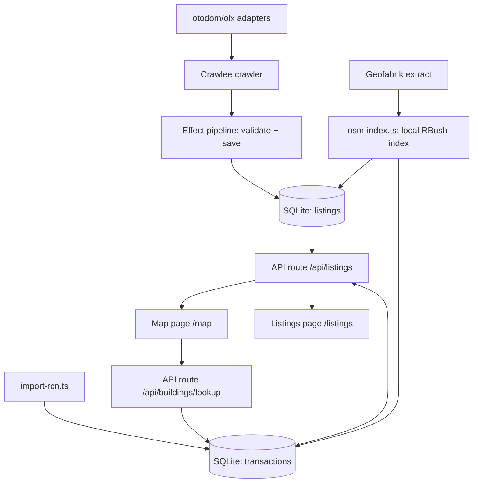

<!-- intent-skills:start -->
## Skill Loading

Use the repository’s installed Intent. If it is unavailable, run `bun install` instead of downloading a replacement.
Before editing files for a substantial task:
- Run `bun run intent list` from the workspace root to see available local skills.
- If a listed skill matches the task, run `bun run intent load <package>#<skill>` before changing files.
- Use the loaded `SKILL.md` guidance while making the change.
- Monorepos: when working across packages, run the skill check from the workspace root and prefer the local skill for the package being changed.
- Multiple matches: prefer the most specific local skill for the package or concern you are changing; load additional skills only when the task spans multiple packages or concerns.
<!-- intent-skills:end -->

# Flat Tracker — Agent & Contributor Guide

Krakow flat-price tracker: scrapes sale listings from otodom.pl and olx.pl,
joins them with historical transaction prices from Poland's Rejestr Cen
Nieruchomości (RCN), and shows every offer on a map anchored to its
OpenStreetMap building.

## Agent skills

Project skills live in `.agents/skills/` and are symlinked into
`.claude/skills/`; `skills-lock.json` pins their sources and hashes.

- `typescript-style-guide`: TypeScript and React conventions. Biome and this
  file's conventions take precedence.
- `vercel-react-best-practices`: React performance. Ignore its Next.js-only
  rules; this app is TanStack Start.
- `web-design-guidelines`: UI and accessibility audit rules.
- `frontend-design`: visual direction for bespoke UI.
- `shadcn`: component-system usage; `components.json` is the source of truth.
- TanStack framework skills: versioned inside `node_modules`, listed and
  loaded through `bun run intent list` and `bun run intent load`.

Precedence: this file and existing code patterns > `components.json` >
`typescript-style-guide` > design and performance skills. A skill must not
override a documented project convention.

## Stack

- **Framework**: TanStack Start (React 19, file-based routing in `src/routes/`)
- **Scraping**: Crawlee 3 + Cheerio (most adapters parse embedded JSON/API
  responses, no browser needed); the WAF-protected sources (booking,
  licytacje-komornik, elicytacje-mf) and the calendar tasks run camoufox
  through `src/crawler/browser.ts` — the only place that launches a browser.
- **DB**: SQLite + Drizzle ORM (`drizzle-orm/better-sqlite3`)
- **Orchestration**: Effect TS wraps the crawl pipeline (`src/crawler/pipeline.ts`)
- **Geocoding**: Overpass API (free) — building footprints + point-in-polygon
- **Map**: mapbox-gl with the Mapbox Standard style (3D landmarks/trees,
  config-driven light), our own RCN `fill-extrusion` layer, listings as a
  GeoJSON circle layer,
  `maxBounds` = the union of the tracked region boxes (Małopolska + Śląsk)
  plus a little slack (a tight box makes `fitBounds` crop the north and south),
  default camera fitted to both. Token: `VITE_MAPBOX_TOKEN` in `.env.local` (public
  `pk.` token — restrict it to the app domain in the Mapbox dashboard).
  Free tier: 50k map loads/month.
- **Runtime note**: `better-sqlite3` crashes under Bun's own runtime
  (`ERR_DLOPEN_FAILED: 'better-sqlite3' is not yet supported in Bun`,
  re-verified on Bun 1.4.0), so a DB-touching TS entry point must never be
  executed *by* bun (`bun src/crawler/...`, `bun file.ts`). Run it through
  tsx, which the package scripts already do (`bun run assign-buildings`).
  This is the one hard exception to bun-first: pure tooling (for example
  `validate:tailwind-scan`) runs as `bun <script>`; the crawler/RCN/server
  entry points stay on Node because they open the SQLite database.

## Toolchain: bun first

Use **bun** for everything it can do: `bun install` (the lockfile is
`bun.lock`), `bunx <tool>` instead of `npx <tool>`, and `bun run <script>` to
run package scripts. Pure tooling runs directly under bun
(`bun scripts/validate-tailwind-scan.ts`); scripts that open SQLite go through
`tsx` (Node) because of the runtime note above — `bun run assign-buildings`
executes `tsx` rather than the file itself. `bun run dev` is fine —
Vite/Nitro run under Node either way.

Do not write `npx` anywhere (docs, comments, log messages). Where a tool has
to come from the project's own dependency tree, name its bin explicitly, e.g.
`bunx camoufox-js fetch` (the registry package `camoufox` is a different,
unrelated package).

## Commands

```bash
bun install               # dependencies (bun.lock is the lockfile)
bun run dev               # start dev server (vite, port 3000); a background refresh
                          # starts 20 s later (see `server/plugins/refresh-on-start.ts`)
bun run db:generate       # new migration from schema changes
bun run db:migrate        # apply migrations
bun run assign-buildings  # match listings/transactions to OSM buildings
bun run geocode-addresses # geocode listings that carry only an address
bun run import:rcn-gugik       # małopolska RCN packages (cadence-gated)
bun run import:rcn-gugik:all   # every GUGiK powiat in Poland (resumable drain)
bun run import:public-investments # Kraków planned/completed projects (--force)
bun run import:finwire         # city flat-price index, Kraków + Katowice (--force)
bun run rebuild:listing-derived # recompute is_visible/property_kind/map anchor
bun run validate:listing-derived # stored derived columns match the pure rules
bun run discover:rcn-powiats   # refresh the GUGiK package catalogue
bun run build:powiats     # regenerate src/data/region-powiats.ts (Overpass)
bun run validate:powiats  # dataset sanity: counts, city centres, overlaps
bun run validate:finwire  # finwire page parsing + chain-index math
bun run validate:upside   # forward-looking upside/risk math
bun run validate:scoring  # alert-score rules, gates and stored-alert invariants
bun run validate:planned-stations # fast-rail station + centre-zone anchor datasets
bun run validate:quality  # condition/quality correction and asking-vs-transaction ratio
bun run measure:asking-ratio # audit the measured asking-to-transaction ratio table
bun run extract:facts     # LLM listing facts (heating, building style, condition) from prose
bun run validate:facts    # extraction prompt, parsing and normalization rules
bun run build:forecasts   # refresh data/forecasts/models.json (price/rent/STR paths + calibrated bands)
bun run validate:forecast # deterministic forecast, conformal calibration and IRR math
bun run validate:tailwind-scan # Tailwind scanner stays out of src/data (timeout-guarded)
```

### Fresh clone: zero-setup bootstrap

`bun install && bun run dev` must work on a clone with no `.env.local` and no
database:

- `src/db/index.ts` defaults `DATABASE_URL` to `./dev.db` (empty value in
  `.env.local` counts as unset) and creates the parent directory if the path
  has one.
- The same module auto-applies `drizzle/` migrations on first use
  (`src/db/migrate.ts`), so every entry point — dev server, Nitro task, tsx
  scripts — gets a working schema. Re-runs are no-ops via drizzle's
  `__drizzle_migrations` journal. A DB that has tables but no journal (made
  with `db:push`) is skipped with a warning instead of failing mid-migration.
- The dev-start refresh fills an empty database: it waits 20 s, then crawls
  every portal. Once `data/crawler/state.json` exists, later dev boots skip
  the crawl entirely so opening the app never competes with a refresh; use
  the /sources page or `DEV_CRAWL=1 bun run dev` when a boot crawl is wanted.
  Reference layers (RCN zip, Geofabrik PBF, GUGiK powiat packages) download
  into `data/` on first run.

Keep it that way: nothing user-facing may require an `.env.local` or a manual
migration step to boot.

**`.gitignore` trap:** the crawl-data rules are `/data/` and `/storage/`
(root-anchored). A bare `data/` also matches `src/data/**`, which silently
kept `src/data/region-powiats.ts` out of every clone while
an API route imported it — the route tree then failed to
load and *every* page 500'd. Never un-anchor those rules, and keep route-level
imports of optional datasets lazy (`await import()`) so a missing data file
degrades one endpoint instead of the whole app.

### Incremental detail enrichment (otodom)

A `firstPageOnly` run gets one request per source unless the adapter asks for
more (`AdapterBase.firstPageOnlyRequests`). otodom spends 14: one newest list
page per estate kind and region (3 kinds x 2 regions = 6) plus up to 8 detail
pages, and only for offers whose detail was never parsed
(`listings.features` is the marker). Detail pages are the only source of a
listing's coordinates, `build_year`, building material/floors, condition and
market — `db-sink` promotes those out of the `features` JSON into columns — and
otodom's CDN rate-limits bulk detail crawls, hence the small budget. A full
crawl (no `firstPageOnly`) still follows every recent detail page.
nieruchomosci-online and rynekpierwotny use the same first-page detail-budget
pattern for their detail-only posting dates (see the data-sources table).

### Building age

The official registry sources carry no construction year: the Kraków RCN
GML (`RCN_Budynek` = id, rodzaj, geometria, adres), the GUGiK RCN
GeoPackages (`bud_*` = id, nr, rodzaj, pow_uzyt, cena, adres) and KIEG EGiB
`ms:budynki` (ID_BUDYNKU, RODZAJ, KONDYGNACJE_NADZIEMNE/PODZIEMNE) all lack
one — checked, do not re-investigate those. The portals that do publish it
are nieruchomosci-online (detail LD+JSON `additionalProperty` "Year built")
and otodom (detail attributes `build_year`); both are parsed into
`listings.features.build_year` and promoted by db-sink. `buildings.build_year`
is derived by `updateBuildingYears()` in
`assign-buildings`: the average `listings.build_year` of the listings anchored
to the building, else the OSM `start_date` tag, else null (never guessed).
`/api/buildings/lookup` returns it and the map popup renders it as
"Rok budowy: 1998 · 28 lat".

Browser binaries are a separate download and their absence must stay
non-fatal (reported once per refresh by `src/crawler/browser.ts`). Every
JS-rendered source — booking, licytacje-komornik, and the booking/airbnb
calendar tasks — goes through that one module, which prefers **camoufox**
(`bunx camoufox-js fetch`, ~660 MB, the anti-detect Firefox that also gets
past Booking's DataDome) and falls back to Playwright chromium only if it is
installed (`bunx playwright install chromium`). Camoufox is a Playwright
driver (playwright-core launches its Firefox build), so the library stays;
what is optional is Playwright's *browser download*. `camoufox-js` is a
runtime dependency for that reason. Adapters that need a browser declare
`launchBrowser` (`CustomLaunchAdapter`), which `crawler.ts` calls instead of
letting Crawlee launch chromium. A missing browser binary is not silent: the
launcher throws `no browser installed: run bunx camoufox-js fetch ...`, so
/sources shows the fix rather than Playwright's bare "Executable doesn't
exist". `warnIfNoBrowser` still logs one line per refresh for the rendered
sources.

Crawl errors keep their cause chain. The pipeline is Effect and
`Effect.runPromise` throws a `FiberFailure` whose own message is the generic
"An error has occurred" (a `Data.TaggedError` starts with an empty message),
so `src/lib/error-report.ts` unwraps the cause under Effect's
`FiberFailure/Cause` symbol and walks nested `Error.cause` links. Every failed
phase records two things: `crawl_runs.error` is the one-line actionable cause
shown in the /sources table, and `crawl_runs.error_detail` is the full cause
chain plus stack traces shown when the row is expanded (also carried live as
`log` on the progress feed). The console keeps a single line; `CRAWL_DEBUG=1`
additionally prints the detail. `pipeline.ts` also fills the `CrawlError`
message itself, so a raw `console.error(fiberFailure)` is still informative.

Crawling is triggered from the UI, not the terminal: the **/sources** page
("Refresh now" → `POST /api/refresh`) runs the same `refreshAll()` as the
hourly task, but in a **child process** (`server/refresh-child.ts`) so the
HTTP server never loads the crawler graph or blocks on its synchronous SQLite
phases. The old `crawl:*` / `import-rcn` CLI scripts were removed.

`geocode-addresses` fills the coordinate gap for portals that hide
lat/lng (morizon, gratka, domiporta, nieruchomosci-online,
licytacje-komornik): the adapters parse a street address
into `listings.address`, this script matches it against the local
`osm_buildings` index (exact street+housenumber → building centroid,
street-only → street centroid) and falls back to Photon (1 req/s,
validated to the tracked regions) for street-level points. Photon queries
carry no voivodeship suffix — one breaks Śląskie lookups
("ul. Mariacka 10, Katowice, Małopolska" returns nothing, "Bytom,
małopolskie" returns clothes shops in Kraków); the postal code is the
qualifier that works in both. Listings
WITHOUT a stored address get one mined from their title (ad speak like
"Łokietka 57B - mieszkanie 30 m²") — the extracted address is persisted.
Free-text mining also runs when a stored address is parseable but resolves
nowhere in the local index (junk like "Padniewskiwgo") — a mined address
that resolves locally replaces it, one that does not leaves it untouched.
Besides the "Street 12" regexes, titles yield conservative lexicon hints
(`lexiconStreetCandidates` in `sites/address.ts`): bare street names in
parentheses ("Kobi House Kraków (Kobierzyńska)") and the halves of tight
hyphen pairs ("Kapelanka-Pychowicka", "Kraków-Grzegórzecka"), accepted only
on exact lexicon resolution (a one-word bare hit must be an exact lexicon
form — declension stems are a trap).
Re-run `assign-buildings` afterwards to anchor the new points. Komornik
titles are legal notices ("... przy ul. Szkolnej dla której SR dla
Krakowa-Krowodrzy w Krakowie ..."), so geocoding cuts the court
boilerplate ("dla której", "Sąd/SR", "Wydział", "KW nr", "z siedzibą")
before mining a street or city — the court's seat is not the property's
location. Bare notarial phrases ("prawo użytkowania wieczystego",
"działka nr 41/6") are rejected as street candidates; explicitly prefixed
streets ("ul. Prawa 5") still pass. For the same reason a city mined from a title only overrides a
generic hint (Kraków/małopolskie/a district); a specific town from the
structured address always wins. The offline town centroid is only used
for unambiguous names: where one village name exists twice in the region
(two "Leśnica"), the centroid map skips it and Photon resolves the name
together with the postal code from the address.

The same pass runs automatically inside every `refreshAll()` with a
Photon budget of 100/run (local index matches are instant), so the
map stays populated between manual drains. The refresh builds the local
`osm_buildings` index *before* this pass when it is missing (`osm-index`
phase): the address matcher reads that table, and on a fresh database the
old order geocoded first, so every address-bearing offer fell through to
the 100-request Photon budget while a local index could have anchored it.
Geocoded positions survive
re-crawls: `saveListings` coalesces coordinates, `address` and
`description`, so address-only adapters never overwrite them with NULL
(a plain `excluded.address` here once wiped 28 geocode-mined budujesie
addresses on the next full re-crawl — every nullable column a re-crawl
can re-emit as NULL must be coalesced in `onConflictDoUpdate`). Street-only addresses anchor
to the local street centroid (no building claim); Photon results
are cached per street in `data/crawler/nominatim-cache.json` (legacy
filename) so
duplicate offers and chunked drain runs never re-query. Pass
`--local-only` to the script to skip Photon (e.g. while the shared
instance throttles).

## Listing facts from prose (LLM)

The bulk portals publish almost no physical facts: of ~11.6k visible flats a
few hundred carry `listings.heating_type`, none of the list feeds carry a
building style, and the otodom detail attributes (which do) are rate-limited
to a handful of pages per run. Sellers still describe all of it in the
listing text ("ogrzewanie miejskie", "kamienica po remoncie", "działka
budowlana z WZ"), so a model reads the title and description and returns a
small, fixed vocabulary the scoring layer already understands.

- **Order of a crawl** (every source, every offer): the adapter scrapes the
  title and the whole description, `runCrawl` sends that text to the model,
  the sink stores the offer together with the facts it just read, and only
  then does `scoreArrivals` score it. The pipeline is
  `crawlSite -> extractFactsForListings -> saveListings -> scoreArrivals`, so
  a stored row is never scored against a blank heating/building/plot column,
  and the day's top-25 cut only ever sees enriched offers. A list-only record
  (no description of its own) is read from the prose the database already
  holds, so a re-crawl enriches it in the same run. Existing rows whose facts
  just landed are re-scored immediately (`factIds`, at most 200 per crawl).
  A model outage never stops storage: a failed batch leaves the offers saved
  without facts and the `listing-facts` repair phase retries them.
- **Where**: `src/lib/llm/` — `client.ts` (transport), `listing-facts.ts`
  (prompt, parsing, normalization; pure) and `extract.ts` (batching, the
  inline pre-store pass, promotion). Transport is TanStack AI (`chat()` with
  the `openaiCompatibleText` adapter), not a hand-rolled fetch.
- **What each source can give us**: `docs/llm-extraction.md` records the
  per-source answer (ten sampled offers each plus a column fill-rate count):
  which sources publish full prose (otodom detail, olx, sprzedajemy,
  adresowo, nieruchomosci-online, gethome, tabelaofert, eLicytacje), which
  publish only a teaser ending in "..." (morizon, gratka, domiporta), and
  which publish none at all (investmap, rynekpierwotny) or fold the notice
  into the title (licytacje-komornik). Prompt v3 adds what that sample showed
  is stated in prose but never published structurally: renovation/roof year,
  energy class, facade and roof state, parking type, storage area, top-floor
  flag, water source and sewage for houses, pool/sauna/jacuzzi, short-term
  rental evidence, plot subdivision and MPZP parameters, and the auction
  metadata (appraisal, round, case number, court, land register, share) plus
  the investment metadata (stage, finish standard, unit and building counts,
  site amenities). New fields live in `listing_facts.facts_json`; only those
  a score reads are promoted to a column, so the vocabulary can grow without
  a migration.
- **Where the gaps are, measured**: `bun run audit:sources` prints the share of
  each source's rows that carry an area, a building type, a heating source, a
  build year, a plot type, model facts and a score, and
  `docs/source-field-coverage.md` keeps the current table. A low percentage is
  a budget, not a missing parser, where the column comes from a detail page
  (otodom's 8-detail budget, nieruchomosci-online's 8-per-page pass), and the
  table makes that distinction visible instead of guessing. `sites/html-attributes.ts`
  is the generic collector that keeps labelled detail values a parser did not
  name (definition lists, table rows, "Label: value", data-label chips) in
  `features`, and adresowo's chip parser (`"1960 | rok budowy"`, the material
  icon, "brak windy", "parter") is what lifted its build-year and material fill.

- **What it fills**: `heating_type`, `building_type`, `plot_type`,
  `building_material`, `condition`, `ownership`, `build_year`,
  `plot_area_m2`, `floor`, `floor_count` and the amenity flags. Only empty
  columns are written (`coalesce(column, value)`), so a portal-published
  fact always wins. Amenity flags go in as 0/1: better-sqlite3 binds no
  booleans.
- **Storage**: `listing_facts` keeps the answer plus provenance (model,
  prompt version, `source_hash` of the text it read, timestamp). An
  unchanged title+description is never sent again; `--force` re-reads
  everything, and `FACT_PROMPT_VERSION` participates in the hash so a better
  prompt re-visits the corpus once.
- **One call per offer, ever** (prompt v5): the hash covers the exact payload
  the model sees (`title` + the stored description), so an unchanged ad is
  never re-read and a changed description is. The description is stored whole
  under one 20 000-char cap (`src/lib/listing-text.ts`); adapters no longer
  slice it at 2 000 chars, because the fact a gate needs (heating, building
  style, plot media) is often in the last paragraph, and the request size is
  bounded by a character budget instead (`FACT_BATCH_CHAR_BUDGET` = 24 000,
  so a batch sends fewer long ads rather than truncated text). An answer that
  names nothing (`{}`) is stored with its hash too, so a text with no facts is
  never retried; a row the model omits from an otherwise valid answer is
  stored the same way, while a failed or unparseable batch writes nothing and
  stays retryable. Ids are deduped per run, and title-only offers (komornik
  notices, investmap rows, whose facts live in the title) are part of the
  input set. `bun run validate:facts` pins the whole contract, including that
  `src/lib/llm/extract.ts` is the only place that calls the model: scoring and
  alerting only read `listing_facts`.
- **Rejects**: the model is a data source, not a trusted one. Unknown ids
  are dropped, values outside the vocabulary become null, numbers outside a
  plausible range become null, a negated mention stays unknown. `bun run
  validate:facts` pins those rules.
- **Runs**: every site crawl reads its own offers before storing them (the
  `facts:` line in the crawl log is that pass). The hourly refresh keeps a
  bounded repair phase (`listing-facts`, `LLM_FACTS_PER_REFRESH` = 300,
  skipped and reported when `OPENCODE_GO_API_KEY` is unset) for offers a
  failed batch left without facts, for rows whose text changed and for the
  legacy backlog; it runs before scoring and re-scores the offers whose gates
  the new facts can flip. The backlog is a manual drain: `bun run
  extract:facts` (`--limit 0` for everything, `--kind plot`, `--dry-run`).
- **Why it matters for alerts**: the flat gate needs municipal heating and
  the plot gate needs building evidence, and both live mostly in prose. There
  is no regex fallback: `src/lib/scoring/heating.ts` resolves the structured
  column, the portal attribute blob and the stored fact, and nothing else, so
  an ad whose text the model has not read yet is `unknown` (and can only
  fill a fallback slot).

## Scheduled (hourly) refresh

Crawls are incremental and idempotent, designed for a once-per-hour cron.
The server runs the refresh, but never the crawl itself: a Nitro scheduled
task `refresh` (cron `0 * * * *`, wired in `vite.config.ts` ->
`scheduledTasks`, `experimental.tasks`) and `POST /api/refresh` both spawn
`server/refresh-child.ts` (`node --import tsx`), which calls `refreshAll()`
from `src/crawler/refresh.ts` in its own process
(`spawnRefreshProcess()` in `src/crawler/refresh-process.ts`). Loading the
crawler graph through Vite's dev module runner blocked every request for
minutes on a cold start, and the synchronous prune/RCN/building-assignment
phases would stall the UI mid-crawl. The task runs in dev AND prod; the dev
server additionally fires one refresh on startup
(`server/plugins/refresh-on-start.ts`, gated on `import.meta.dev`), through
the same runner (`server/boot-refresh.ts`). Live progress and the
cross-process single-flight guard travel through `data/crawler/refresh.json`
(`src/crawler/refresh-lock.ts`): `/api/crawl-status` merges it, `/api/refresh`
reports it as already running, and `refreshAll()` refuses to start while a
live child holds it. The record's heartbeat stalls while a bulk import blocks
the event loop, so the lock treats a live pid as authoritative for 30 minutes;
a 90 s window expired mid-GUGiK-import and let the hourly task start a second
child on the same database. A deployment without `server/` or `tsx` (built
`.output/` only) falls back to running `refreshAll()` in-process.

Manual equivalents:

```bash
# /sources page "Refresh now" button → POST /api/refresh (recommended)
curl -X POST http://localhost:3000/_nitro/tasks/refresh   # server task
```

`refreshAll()`: refetches all sources, upserts new/changed listings, prunes
otodom/olx listings older than the since window (default 90 days), then
refreshes RCN transactions (HEAD check; skips when nothing changed) and the
region-wide GUGiK per-powiat GeoPackages — małopolska scope by default
(20 h cadence gate, effectively daily on the hourly cron); set
`RCN_GUGIK_SCOPE=poland` to make the server refresh cover the whole country
instead. When either import inserts new rows, building assignment
(`assign-buildings`) re-runs automatically so new price history shows up
colored on the map. The run's final passes are the `listing-derived`
phase, which recomputes `is_visible`/`property_kind`/map anchors for the
map and table, and the `scoring` phase, which scores new offers and
appends today's top-25-per-segment alerts (see "Alert scoring" below).
Portal failures are isolated per site (one blocked portal does not abort
the rest of the run). The task and plugin are registered explicitly in
`vite.config.ts` (no Nitro directory scanning — TanStack Start owns
`src/routes`); the handler path must be an absolute file URL, relative
paths fail to resolve from the virtual tasks module.

**Whole-country loads are a manual drain** (`bun run import:rcn-gugik:all`):
GUGiK publishes one GeoPackage per powiat nationwide (380 packages,
~5.3 GB), so it is not something an hourly server task should pull. The
run is resumable — `data/rcn/gugik/state.json` records the last successful
import per TERYT4, and the cadence gate skips those powiaty on a re-run —
and idempotent, so interrupting it costs only the powiat in flight. The
package catalogue lives in `data/rcn/gugik/teryt-index.json`, discovered
by HEAD-probing the URL space (`bun run discover:rcn-powiats`,
`src/crawler/rcn-gugik-index.ts`); discovery is additive so a flaky probe
can never shrink the catalogue. Kraków (1261) is skipped in both scopes:
`import-rcn.ts` already imports the richer city GML, and a second copy
under `1261-G/...` ids would double-count Kraków in the building price
history. Rows outside the tracked regions keep their registry coordinates
but stay unbound — the `osm_buildings` index covers małopolskie + śląskie.

### Alert scoring

Every refresh ends with a `scoring` phase (`src/crawler/refresh.ts`) that
runs `runAlertScoring({ incremental: true })` in the refresh child process,
never in the HTTP server: every active sale offer without a current-version
score is scored exactly once, then the new top-25 per segment is
appended to today's `listing_alerts`. The phase shows on /sources
(descriptor id `scoring` in `src/crawler/source-status.ts`) and is recorded
in `crawl_runs` (alerts as new, scored offers as updated); scoring failures
are isolated and never abort the refresh. The engine is deterministic
rules over the valuation comps, no ML model; `docs/alert-scoring.md` has
the component breakdown and rationale.

- **New offers are scored on arrival and update the day's list**
  (`scoreArrivals`, called from `src/crawler/pipeline.ts` after `saveListings`
  returns `newIds`), not only at the end of the refresh. The crawl's own
  facts are read before the save, so the score sees them; only then is the
  row scored and the day's cut rebuilt. Once the arrivals are
  scored, `scoreArrivals` rebuilds today's leaderboard immediately (at most
  once per `ALERT_REBUILD_MIN_INTERVAL_MS` = 15 s, because a site can deliver
  hundreds of offers in one burst), so /alerts grows during a crawl instead of
  waiting for the scoring phase; the fresh-arrival appends run after the
  rebuild, since a rebuild replaces the day's cut. `/alerts` polls the feed
  every 30 s for the same reason. Scoring is advisory there: a failure is logged
  and swallowed, and the final phase cleans up whatever was missed. Scoring
  per site means an offer is scored within seconds of being stored, with its
  heating/building/plot evidence already in the row.
- **Fresh-arrival alerts compare against the last 24 hours**: a newly
  scored offer that passes the gates is appended to today's list when it
  sits inside the top `ALERT_FRESHNESS.topPercent` (5%, at least one
  position) of the offers first seen in the previous 24 h in the same
  region and segment. The cohort uses
  `coalesce(firstSeenAt, listedAt, scrapedAt)`, so a portal posting date
  never drags an old offer in. The row carries
  `payload_json.reason = "fresh_arrival"` plus the cohort size, and
  `/api/alerts` labels it; this path is additive, the market-wide cut below
  still runs.
- **The daily list is the top 25 offers per segment**
  (`ALERT_TOP_OFFERS`), not a percentage of the pool: every run ranks all
  scored, active offers that pass the gates, flats, houses and plots
  separately (across both regions), and keeps only offers inside the cut.
  Today's list is replaced on every run with the current cut
  (older dates are untouched), so a better offer that appears during the
  day is shown and one that loses its place disappears; the row keeps its
  original `createdAt` (freshness badge). Re-runs are idempotent through
  the unique `(listing, alert_date, channel)` index. The rule is recorded
  on each row (`payload_json.cut = "top25"`) and `/api/alerts` enforces
  the same ceiling on the response, so a date that still holds older
  5%-era rows never shows more than 25 per category. Changing the cut is a
  selection change, not a score change, so it does not require a
  `SCORE_VERSION` bump.
- **Amenities add points on top of the weighted score**
  (`AMENITY_BONUSES`): district heating or a heat pump +5, a tram stop
  within 300 m +5 (flats in Kraków/Katowice), a railway station within 1 km
  +5, a park within 300 m +3, water within 500 m +2, elevator +2, parking or
  garage +2. Each is a separate named reason on the card. The bonus is
  scaled by the remaining headroom, `* min(1, (100 - weighted) / 30)`, so a
  strong offer still gains without every top candidate collapsing into the
  same 100; the score stays strictly increasing in the weighted
  components. Fast rail and the centre zone add their own points (see the
  next bullets). This changes stored scores, hence `SCORE_VERSION` 2027.14
  (a re-score is required).
- **Fast-rail and centre-zone layers decide who can alert**:
  `src/data/fast-rail-stations.ts` lists the 200 km/h+ stations in both
  regions (Kraków Główny, Katowice, Zawiercie, Tychy, Bielsko-Biała Główna,
  Gliwice) with the services each carries; the documented planned KDP call
  (2035+, via the modernised CMK) is `kdp_2035` on Kraków Główny, Katowice
  and Zawiercie. 160 km/h corridors are deliberately excluded. Plots must sit
  inside the 20 km catchment of one of those stations (measured from the
  listing point) or fail as `outside_fast_rail`; houses are not gated. The
  gate is a catchment, not the walkable ring: at 3 km only 5 of 644 live plots
  passed and none had a comparable, so the Działki section was always empty.
  `src/lib/scoring/centre-zone.ts` holds explicit anchors for the target
  Kraków neighbourhoods (Rynek Główny, Kazimierz, Podgórze, Krowodrza,
  Grzegórzki, Dębniki, Zwierzyniec, Wola Justowska) plus the Katowice Rynek;
  flats must sit inside 4 km of one of them (`outside_centre_zone`). Both
  datasets are pinned by `bun run validate:planned-stations` and appear on
  /sources as the static `planned-rail` layer. Coordinates are the OSM
  station nodes the map already draws; a wrong entry can only shift a score.
- **Eligibility is a hard filter before the discount gate**: flats must
  prove district heating or a heat pump (gas, electric, coal and oil fail as
  `non_municipal_heating`, an ad that never says fails as
  `no_heating_evidence`), must not sit in an old block (2027.17: a
  large-panel building, or a block proved to predate 2000, fails as
  `old_block`; tenements, new blocks, apartment buildings and blocks of
  unknown age are allowed) and must sit in the centre zone. Plots need
  evidence that
  something can still be built on the parcel (a building plot type or
  built-up land-use class B*, MN, MW, RM, a WZ decision, a zoning plan, or
  the same evidence read from the ad by the extractor) and must sit inside
  the 20 km fast-rail catchment. An estimate built from fewer than three comps
  fails. The score row stores `eligible` and the leaderboard filters on it,
  so a rejected offer stays in the table and is rarely alerted. Plot
  forest/lake points are tiered: on or next to the parcel (radius + 20 m)
  three times the base value, within 3 km a third, beyond that nothing.
- **Houses are holiday properties, not spare land** (2027.21): the target is
  a unique, atmospheric old or wooden house with nobody next door, in the
  wild near water, forest, mountains or a park, that earns from short-term
  rental. Buildability and the fast-rail radius do not apply. The gates are
  `no_nature_setting` (water within 1 km, forest within 800 m, a park within
  500 m, or a lake/river/forest/mountains setting the extractor read) and
  `no_house_character` (wood construction, pre-1945 or pre-1980, a 1500 m²+
  plot, or real solitude). Character is a delta on the house property
  component (wood +12, timber frame +6, pre-war +10 / pre-1980 +6, big plot
  +6, nothing within 500 m +20, 250 m+ +14, 100 m+ +10, no other building
  within 150 m +10, a neighbour under 25 m -12). Isolation is
  measured from the 3.2M-footprint `osm_buildings` index (nearest building,
  count within 150 m, own footprint under 20 m ignored) and the rental market
  is the median nightly price of the airbnb/booking rows within 2 km; both
  live in `src/lib/scoring/house-nature.ts`, cached per 250 m cell. Holiday
  bonuses: water within 300 m +8, forest +6, park within 500 m +5, mountains
  +4, solitude +6, wilderness (nothing within 500 m) +8, STR market +2/+4/+6
  above 250/400/600 zł per night, and STR offer density +2/+4/+6 at 30/60/120
  booking+airbnb rows within 2 km (the same density signal scores a plot).
  The isolation distance, the nightly median and the offer count are stored
  in `amenities_json` (`neighbourM`, `neighbours150m`, `strNightly`,
  `strSample`, `strOffers`) and shown on the card.
- **The fair value must survive a plausibility check** (2027.16). Three
  failures showed up in the live list and each is now a gate:
  `placeholder_coordinates` (the coordinates are a point dozens of
  street-less listings share, i.e. an adapter/geocoder wrote the city centre:
  a Giszowiec flat sat 62 m from the Katowice Rynek, a Janczowa plot 100 km
  from its village, and a Skotniki plot on the Kraków Rynek, so the comp set,
  the centre-zone distance and the fair value were all fiction);
  `implausible_discount` (55% or more below the median, which was a 1000 m²
  village plot "94% below" central building land and a 156 m² industrial
  plot at 85%); `unverified_discount` (35-55% below needs at least 15 comps
  and a 25% interquartile spread, because the ordinary estate flats carried
  33-44% "discounts" built from wide sets); and `broken_index_factor` (the
  median factor that carries comps to today outside 0.9-2.0, which was
  x5.07, x2.20 and x1.92 on 2021-2022 house comps and x0.85 on a three-year
  Katowice span). A factor between 1.6 and 2.0 costs `high_index_factor`
  risk points without rejecting the offer. The placeholder set
  (`src/lib/scoring/placeholder-points.ts`) is one aggregate query per run:
  a point shared by five or more street-less, building-less sale listings,
  keyed to five decimals (about a metre).
- **The daily cut is deduplicated and diversified** (selection, not score):
  the same offer syndicated twice (`city + street + area + 1% price` band)
  keeps its best row only, and one investment fills at most
  `ALERT_MAX_PER_INVESTMENT` (2) of a segment's 25 slots. A developer price
  list is not 25 opportunities: half a live column was five units of
  "Park Matecznego" plus six of "Stańczyka II".
- **Gates are evaluated independently** (`gateFailures`, first one kept as
  `gateReason`), which is what makes `fallback_eligible` possible: a flat
  that failed *only* on `no_heating_evidence` (or a plot on missing building
  evidence) fills a section that cannot reach `ALERT_TOP_OFFERS` 25 with
  fully eligible offers. Fallbacks rank below every eligible offer and the
  card marks them; a gas/electric/coal/oil flat, or a flat proved to sit in
  an old block, is never a fallback.
- **Every flat/house card states the building class and the heating**
  (`src/lib/building-class.ts`): kamienica, stary blok (wielka płyta or
  pre-2000), nowy blok, apartamentowiec, blok with no stated age; `nieznany`
  when nothing describes the building, flagged `building_class_unknown`.
  Heating is `miejskie` / `pompa ciepła` / `gazowe` / `elektryczne` / ...,
  `nie potwierdzone` when the model found no statement. The label is derived
  once per request from the model's style reading, the structured type and
  the build year, and appears on the alert card, the map popup, the
  expandable table row and the offers table. Only blocks carry the year
  threshold: a kamienica (and any pre-1945 building) is accepted at any age,
  including a post-war one built before 2000.
- **Prose is read by the LLM first**: the description-derived heating,
  building style, tenement age, plot zoning/media and defect evidence all
  come from `listing_facts` (`src/lib/llm/`, prompt v5). A narrow,
  negation-aware lexicon (`src/lib/scoring/prose-lexicon.ts`) backs the model
  up for the rows it has not seen: it only takes an explicitly named source
  (`ogrzewanie miejskie`, `MPEC`, `piec gazowy`, `grzejniki elektryczne`,
  `pompa ciepła`, `węgiel`) or building (`mieszkanie w bloku`, `kamienica`,
  `apartamentowiec`, `wielka płyta`), rejects a negated mention (“bez
  ogrzewania miejskiego”) and never reads “CO”, “podłogówka” or “stare
  budownictwo” as a fact. A hit is reported as `source: "prose"`, below the
  column, the portal attribute and the model, so a stored value always wins;
  `validate:scoring` pins both the positive and the negative cases.
- **The fair value carries two corrections** (`listing_scores.valuation_json`):
  the time factor that brings each RCN comp to today through the chain-linked
  index (nominal, so inflation is inside it) and the condition/quality
  correction from `src/lib/valuation/quality-factor.ts` (balanced two-sided
  deck, +-15% clamp, named reasons, neutral when no facts).
- **The comp set is at most 30 mixed comparables** (2027.19, house ladder added in 2027.23):
  `estimateSaleValue` always gathers RCN transactions *and* the active offers
  in the same radius, carries the RCN side to today through the index, converts
  the asking side to the transaction level with the measured asking ratio, and
  keeps the 30 highest-weight comps. Flats and plots use 1 km; houses step
  through 2 km, 5 km and 20 km, keeping the nearest tier that yields a valid
  set, because a rural holiday house often has no RCN sale and no other
  listing in its own neighbourhood. Before the house widening such offers
  were left unscored (`no_comparable_estimate`) and absent from the alert
  list. The radii and cap are a product decision (evidence a buyer can
  reasonably compare), so they sit outside the backtest optimum that tuned
  the bands and the weighted median. `RADII_BY_KIND` and the caps in
  `comp-selection.ts` carry the values; changing them needs a `SCORE_VERSION`
  bump.
- **Plot comps read land use from the RCN parcel metadata**:
  `parcelFamilies()` maps `parcel_meta.land_use`
  (`gruntyZabudowaneIZurbanizowane`, `gruntyRolne`, `gruntyLesne`, ...) to the
  same families as an EGiB class symbol, with `parcels.land_use_class` as the
  fallback. Before this, the only source was the EGiB `parcels` import, which
  defaults to zero tiles per refresh, so every RCN plot comp was "unknown" and
  a plot advert that named its type could not use a single RCN sale.
- **/alerts always renders three fixed sections**, even when empty:
  Mieszkania, Domy z działką and Działki, fed by `/api/alerts` (latest
  alert date by default, optional `region`/`segment`/`date` filters). Rows
  whose alert was created in the last 24 h carry `isFresh` and a "Nowa
  (24h)" badge and sort first inside their section; the response also
  reports `freshCount` and `generatedAt`. Each card shows the offer's
  physical facts (build year, heating, material, building type, floors,
  market, condition, ownership, plot area, amenity flags), the nearest named
  park/forest/water/station/tram/bus with distances (a distance is shown
  only when its feature has a name, never inferred), and the valuation
  sample (`Wycena z N ofert, w tym M z RCN`).
- **The valuation median's sample is stored with the score**:
  `listing_scores.comp_count` and `comp_rcn_count` hold how many
  comparables (total, RCN-only) the weighted median used, capped at 30 and
  at least 3. `0` means "not recorded" (a row written before the columns
  existed), so consumers treat it as unknown, not as "no comparables".
  `amenities_json` carries the nearest feature names next to their
  distances. Because an alert keeps the score row that raised it, the
  alert feed reads the listing's current-version row for these two fields
  when the alert's own row predates them.
- **Re-score after a gate change**: `bun run rescore:candidates` re-scores
  the offers that can actually alert (every house and plot, the flats inside
  the centre zone) at the current `SCORE_VERSION`; `--all` widens it to the
  pool, `--limit N` bounds it, `--dry-run` reports without writing. A full
  pool re-score is hours of comparable queries.
- **Policy constants are versioned** (`src/lib/scoring/config.ts`):
  weights, curves, distance bands and gates sit behind `SCORE_VERSION`,
  and any change to a policy value requires a `SCORE_VERSION` bump so
  stored scores stay auditable (`listing_scores` keeps one row per listing
  per version). Incremental runs then re-score the pool under the new
  version.
- **Daily re-score at 06:30**: the `score-listings` Nitro task (cron
  `30 6 * * *`, wired in `vite.config.ts` like `refresh`) re-scores recent
  offers on top of the incremental pass. It spawns `server/score-child.ts`
  through `src/lib/scoring/process.ts`, single-flighted by a pid lock in
  `data/scoring/score.lock` (a stale lock from a crashed run is replaced);
  without the TS runner it falls back to an in-process run. Manual
  backfill: `POST /_nitro/tasks/score-listings` with a JSON payload like
  `{"all": true, "limit": 500, "dryRun": true}`, or
  `{"all": true, "listingIds": [1, 2, 3]}` to re-score exactly the
  listings a display change affects (for example the alert rows that
  predate `comp_count`) without touching the whole pool.

`bun run validate:scoring` pins score monotonicity, the gates, the
fresh-arrival cohort rule and the stored-score/alert invariants.

### The /sources registry

`src/crawler/source-status.ts` is the single literal registry of every
source the app uses: the 20 portals, the data layers (`rcn-import`,
`gugik-import`, `price-indices`, `finwire`, `public-investments`,
`osm-index`, `osm-roads`, `terrain`, `egib-import`) and the processing
phases (`geocoding`, `airbnb-calendar`, `airbnb-enrich`, `building-assign`,
`parcel-assign`, `parcel-enrich`, `listing-derived`, `scoring`). Each
descriptor declares `group` (`portal` | `data` | `processing`), and the
bundled datasets (`railways`, `uniqueness`) set `static: true`. The file
must stay a literal — it may not import `sites/index.ts`, because
`/api/crawl-status` and the /sources page read it on every request.

Every phase records its own `crawl_runs` row (counts in
`newCount`/`updatedCount`, failures through the shared error report), so the
page can show a real "last refreshed" per source. While a run is in flight the
page also shows one overall bar plus live numbers (`RunProgress` in
`/api/crawl-status`): offers stored and per-minute rate from the crawl phase,
the current phase and its counter, elapsed time and an ETA. The bar is
weighted by `PHASE_WEIGHTS` in `src/crawler/progress.ts` (the crawl is about
45% of a run), because counting phases equally left it at 4% after the whole
crawl had finished. The facts and scoring phases report `done`/`total`
through their `onProgress` callback, so their row moves too. `/api/crawl-status` adds
`lastRefreshedAt` (newest successful finish across non-static sources),
per-source `lastSuccessAt`, and passes `group`/`static` through; the panel
groups the table into Portale, Dane i warstwy and Przetwarzanie i scoring,
and a static layer reads "wbudowane" instead of a time. When adding a new
import or phase, register its id here and record its run, or it will crawl
without ever appearing on the page.

### Transaction scope: the tracked regions, explicitly

`transactions` holds the country, but **every screen is regional** —
listings come from małopolskie and śląskie portals, the choropleth and the
price charts cover both voivodeships, the map is bounded to the union of
their boxes. So a
bare `FROM transactions` in a route is a bug waiting for the next national
drain: it silently turns a Kraków chart into a national average, and the
choropleth would push ~20M out-of-region rows through point-in-polygon on
every request. Regional queries therefore carry `inTrackedRegions` from
`src/db/region.ts`.

Two consequences worth knowing:

- **The region is a column, not a coordinate test.** `TRACKED_REGIONS`
  (src/db/region.ts) holds the two boxes, `transactions.region` is a VIRTUAL
  generated column that turns them into `'malopolskie'` / `'slaskie'` /
  NULL, and queries say `region is not null` — the predicate
  `transactions_region_price_idx` (schema.ts) is partial on, verbatim. A
  single-voivodeship slice is `inRegion("slaskie")`, still bounded by that
  index (measured 0.8 s vs 0.3 s index-only region-wide for the monthly
  price series). The indirection is not cosmetic: SQLite does not match a
  partial index whose WHERE clause is OR-connected, so the two boxes written
  as `(box) or (box)` — identically in the index and in the query — still
  planned as `SCAN transactions` (8.1 s at 24.3M rows; `INDEXED BY` answers
  "no query solution"). One box covering both voivodeships does match an
  index but swallows Kielce and Opole. `bun run validate:regions` compares
  the stored generated expression, both predicate texts and the resulting
  `explain query plan` with the code, so a drifting box fails loudly instead
  of mis-bucketing new rows.
- Rows without geometry never carry a `region` (the column is derived from
  `lat`/`lng`), so they drop out of every region-scoped aggregate. They could
  never be attributed to a powiat anyway, and the coordinate boxes cover
  each voivodeship's full extent, so no in-region point is left unlabelled
  (`validate:regions` asserts exactly that over the whole table).

The per-powiat choropleth (`/api/powiat-map`) was removed in the analytics
cleanup. The region-scope machinery it used is still the contract for every
analytics query: `transactions.region` plus the two partial indexes. The
`region` column also lets the per-powiat series use the date-first index
(`transactions_region_date_idx`) instead of scanning the national
`parcel_id` index; `validate:regions` asserts that plan.

**Server refreshes fetch only the first, newest-sorted page per site**
(`firstPageOnly: true`, the default in `refreshAll`): each hourly run
captures just the offers that appeared on page 1 and skips pagination and
detail-page follow-ups. `alwaysFullCrawl` opts a source back into full
pagination (investmap: small private investments sit past pages that have
no flats, so skipping page 1 would hide them; licytacje-komornik: the
Małopolska + Śląsk court-auction feeds are tiny, so every run re-syncs the whole
list; budujesie: the forum list is sorted by last-post activity, so the
deep pages hold the corpus and every run re-syncs all ~52 topic pages).

**Dev-start runs are diff-only** (`server/boot-refresh.ts` calls
`runRefreshChild({ diffOnly: true, sinceDays: DEV_SINCE_DAYS })`): each site's
`since` window is `max(now - 7 days, last successful crawl)` — per-site
last-run timestamps live in `data/crawler/state.json` — so a boot only
loads what the portals added since the previous load, and otodom/olx
history is pruned to the 7-day cap. Dev-start runs are also first-page-only.

- Upserts by `(source, externalId)`: re-running is safe and self-refining
  (detail pages add coordinates to list-page records). Each run reports
  the portal diff — how many listings are NEW vs UPDATED.
- Cross-source dedupe in `/api/listings`: rynekpierwotny project rows are
  hidden when the same investment is covered by investmap (exact
  street+housenumber, street-only when the project has no housenumber,
  or normalized investment-title match). Both sources remain selectable
  individually in the UI filters.
- The fetch window is bounded by `sinceDays` (default 90) and older
  otodom/olx listings are pruned afterwards, so the DB only holds
  active/recent offers.
- `importRcn()` starts with a HEAD request on the
  zip; when ETag/Last-Modified match `data/rcn/version.json`, it skips
  the 2 GB download+parse and reports 0 new transactions. When the file
  changed, only rows that are actually NEW are inserted
  (`INSERT OR IGNORE ... RETURNING`), so each run imports exactly the
  diff the registry added.
  Run `bun run assign-buildings` after an RCN refresh to anchor the new
  transactions.
- The crawler paces requests (3 concurrent, ~350 ms delay) and retries
  403s with backoff to stay under portal throttling. Note: Crawlee swaps
  `enqueueLinks` for a no-op stub on non-HTML responses, so JSON-API
  adapters (investmap, komornik) paginate via `addRequests` instead.
- **Blocked portals stop, they never get hammered**: a 429 (or 5 blocked
  403 attempts) ends that source's crawl immediately
  (`blockStatus`/`makeBlockTracker` in `crawler.ts`; `retryOnBlocked: false`,
  `maxRequestRetries: 2`, and `request.noRetry` on the first 429) and the
  source is paused for 2 h via `blocked:<site>` in
  `data/crawler/state.json`. The next `refreshAll()` skips it entirely —
  not one request — and the run summary says "blocked earlier — retry
  after HH:MM". "Try later", never "try again now". A single burst-403
  (otodom/olx) keeps its bounded retries and does not trigger the pause.
- **The hourly cron runs whatever build is deployed**: the Nitro task lives
  in the server process, so a stale `:4173` prod build keeps scraping with
  old adapter logic — observed re-upserting 854 rows a fresh prune had just
  removed, within the hour. Rebuild + restart the prod server whenever crawl
  logic changes (`bun run build`, then relaunch `.output/server/index.mjs`).
- `runCrawlWithRetry` (exponential backoff) backs every site crawl in the
  server refresh task.

`assign-buildings` uses a **local OSM building index** (`osm_buildings`
table) built from one Geofabrik extract per tracked voivodeship
(`data/osm/malopolskie.osm.pbf` and `slaskie.osm.pbf`, ~200 MB each,
streamed with `osm-pbf-parser`). The index covers **both voivodeships** in
full (not just Kraków), so region-wide sources (booking, airbnb: Zakopane,
Katowice, ...) anchor too.
Point-in-polygon matching then runs in-memory via RBush — the public
Overpass API is far too rate-limited for the ~84k RCN transactions. The
index is rebuilt automatically when missing *or built from an older region
set*: `data/osm/build-state.json` records which extracts the current rows
came from, so adding a voivodeship triggers exactly one rebuild (the table
is replaced, not merged — a footprint row does not record its extract).
`bun run assign-buildings`
assigns all 84k transactions in minutes, not hours.

Both the rebuild and the matching index are memory-shaped for the server
process, because that is where they run (the refresh calls
`assign-buildings`): ~3.2M footprints are loaded at a time and the default
V8 heap is 4.4 GB. What that costs, measured on dev.db: a typed array per
footprint plus a parsed tag object peaked at 3.9 GB (one OOM away from
killing the dev server), so rings now live in a single shared `Float64Array`
addressed by offset/count, rows are read in pages instead of one
`select()`, and `polygon`/`tags` are fetched per building only when a
footprint is first inserted into `buildings`. Same load, 1.7 GB, and the
whole flow (parse two extracts, insert, load, probes) finishes in ~3.5 min
with the build's peak at ~2 GB. If you touch the loader, watch
`process.memoryUsage()` — the failure mode is a crash, not a slow run.

## Data sources

| Source | What | Access |
|---|---|---|
| otodom.pl | Active sale listings — flats, houses and plots — Małopolska + Śląsk | HTML `__NEXT_DATA__` JSON; list pages have no coords, detail pages (`/pl/oferta/`) add lat/lng, `build_year`, building material/floors, condition, market (`attributes`, promoted by db-sink). The sale adapter walks `/sprzedaz/{mieszkanie,dom,dzialka}/{region}`; `estate`/`category.id` set the row's property kind. The hourly detail budget is 8; `OTODOM_DETAIL_BUDGET=N` drains a fresh backlog in one run (a CloudFront 429 pauses the source for 2 h) |
| otodom.pl (wynajem) | Long-term rental listings — flats, houses and plots — Małopolska + Śląsk | Same `__NEXT_DATA__` path, `/wynajem/{mieszkanie,dom,dzialka}/{malopolskie,slaskie}`; detail price read from `rentalPrice` |
| olx.pl | Active sale listings — flats, houses and plots — Małopolska + Śląsk | HTML `window.__PRERENDERED_STATE__` JSON incl. coordinates; the regional landing page carries all three categories and the adapter keeps category ids 14/15/16 (flats), 18/20/22 (houses) and 24/25/1311 (plots). The rent adapter reuses the same landing with the `wynajem` ids (15/20/25) |
| morizon.pl / gratka.pl | Same feed (one company), agency-heavy; flats, houses and plots | schema.org LD+JSON (`Offer` nodes); pagination `?page=N`. The result cards carry "Dodane: YYYY.MM.DD", parsed into `listedAt`; `itemOffered.@type` (`Accommodation`/`House`/`Place`) sets the property kind |
| domiporta.pl | Agency listings: flats, houses and plots | LD+JSON `@graph` `ItemList` of `RealEstateListing`; pagination `?PageNumber=N`; `datePosted` is the posting date and the URL slug supplies the kind |
| nieruchomosci-online.pl | Agency listings: flats, houses and plots | LD+JSON `CollectionPage` offers (`?1,dom`, `?2,dzialka`, `?3,mieszkanie`); pagination `&p=N`. The list has no date or coordinates, so a detail pass (max 8 uncached details per list page, cached in `data/crawler/nieruchomosci-online-details.json`) fills `listedAt` from `datePosted` plus `geo` coordinates |
| adresowo.pl | Direct-from-owner sale listings: flats, houses and plots, Małopolska + Śląsk | Server-rendered `div[data-offer-card]` cards (40/page) at `/mieszkania`, `/domy` and `/dzialki` with the `fma`/`fsl` region codes; `<link rel="next">` pagination. The list has price/area/rooms/street but no coordinates, so a detail pass (max 8 uncached details per list page, `data/crawler/adresowo-details.json`) reads the detail `Place` LD+JSON `geo`/description. No absolute posting date (relative copy only), so `firstSeenAt` is the date |
| gethome.pl | Agency-network sale listings: flats, houses and plots, Małopolska + Śląsk | `window.__INITIAL_STATE__` `offerList.offers.offers` on `/nieruchomosci/<region>` and `/dzialki/<region>`, pagination `?page=N`; every offer carries price, area, rooms, floor, coordinates, address, agency and `created_at` |
| sprzedajemy.pl | General classifieds: flats, houses and plots, Małopolska + Śląsk | `.../nieruchomosci/{mieszkania,domy,grunty-i-dzialki}/sprzedaz`, 30 cards/page, `?offset=N`. Cards carry price/area/city/district and `<time datetime>`; a detail pass (max 8 uncached details per list page, `data/crawler/sprzedajemy-details.json`) adds rooms/floor/build year and `data-coordinates` |
| tabelaofert.pl | New-development units: flats, houses and plots, Małopolska + Śląsk | `/mieszkania`, `/domy` and `/dzialki` per region, `?page=N`, embed a schema.org `Product` whose list `offers.offers` are projects plus direct single-property offers. `/inwestycja/...,i<id>` details carry the unit inventory (area, rooms, floor, price); every unit's `geo`/`address` is an `@id` reference to the page's single node, so the adapter scans the LD+JSON once and applies that place to all units. Direct `/oferta/...` pages carry their own geo/address. Both passes are gated by `data/crawler/tabelaofert-investments.json` (3-day TTL); `TABELAOFERT_DETAIL_BUDGET=N` drains a fresh backlog |
| rynekpierwotny.pl | New-development projects (osiedla): flats and houses | `window.__INITIAL_STATE__` `offerList.list.offers` with geo points + price ranges; `/s/nowe-mieszkania-*` and `/s/nowe-domy-*`, pagination via the state `next` link. The list omits the posting date; a cached detail pass (max 6 uncached details per list page, `data/crawler/rynekpierwotny-offers.json`) reads `offerDetail.offer.configuration.publish_date` (fallback `create_date`) |
| investmap.pl | **Every registered investment in Kraków and Katowice with its flats or houses** (incl. small private ones) | Public JSON API `GET /api/investment/search?withEstates=1&categorySlug={mieszkania,domy}&citySlug={krakow,katowice}&offset=N` — units inline (`es[].list`): area, price, price_m2, floor, rooms; coordinates from the investment. Construction timeline: `GET /api/investment?id=<id>` carries `investment.finish` (`{title: "I kw. 2026", date: "2026-01-01"}` = the "realizacja" quarter shown on /miasto/krakow, quarter-start date, planned or actual, the source does not distinguish; search rows only hold empty `finish: {}` placeholders). Stored per unit as `construction_end_label`/`construction_end_date` in `features`, promoted to columns, exposed by /api/listings as `constructionEndLabel`/`constructionEndDate`. Investmap publishes NO construction start date and NO status field (checked the whole API surface), so none are stored. Detail fetches are gated by `data/crawler/investmap-investments.json` (30-day TTL). Investments with NO units for sale (sold out, early phase) would otherwise be invisible entirely: the adapter emits one price-less investment-level row per building (`externalId` `inv-<id>`, `features.investment_row`), and `/api/listings` hides that stand-in again once unit rows for the same `features.investment_id` appear |
| licytacje.komornik.pl | Court auction notices (Małopolska + Śląsk real estate, all subcategories) | Playwright only (WAF blocks non-browser TLS); anonymous JSON API `POST /services/item-back/rest/item/search` (same-origin, `termFilters` + `fullTextFilters` city, `offset` pagination); every REAL_ESTATE subcategory kept |
| mapalicytacji.pl | Non-komornik auctions and tenders: gminne, AMW (military), KOWR (agricultural land), skarbowe/KAS, PKP, Orange, TAURON | Server-rendered cards with `/przetarg-*` and `/nieruchomosc-*` detail links, `?strona=N` pagination. Detail pages carry schema.org Place/RealEstateListing, a `table.details` (area/price/deadline) and usually `var it = {...}` with exact coordinates. Regional KOWR/skarbowe lists plus coordinate/region filtering for national categories; detail cache `data/crawler/mapalicytacji-details.json` (3-day TTL). Rows unseen for 14 days are pruned. Kept alongside the direct `elicytacje-mf` source: the mirror also carries gminne/AMW/KOWR/PKP and its KAS copy can lag the official portal |
| elicytacje.mf.gov.pl | Official eLicytacje KAS: tax-office auctions (licytacje skarbowe), tenders and "obwieszczenia o oszacowaniu" for Małopolska + Śląsk | Incapsula WAF; a real browser is required and its cookies must survive between runs, so the adapter launches camoufox with a **persistent profile** (`data/crawler/elicytacje-mf-profile`) instead of a fresh context. The SPA API is same-origin and fetched from inside the rendered page: `POST /auction/api/v1/announcement/external?page=N&size=100` with `{sectionId: Nieruchomości, filters: {location: małopolskie\|śląskie}}` (~95 active rows), then `GET /v1/announcements/{uuid}` + `GET /v1/items/{itemId}`. Details carry the address, category, description, area/rooms/floor parameters and the deposit (wadium); no coordinates, so `geocode-addresses` anchors them. Detail cache `data/crawler/elicytacje-mf-details.json` (3-day TTL, refetched when the electronic state changes). Active states only (`WAITING`/`INPROGRESS`), ended auctions ignored; rows unseen for 14 days are pruned |
| budujesie.pl | Investments under construction (Kraków housing), one phpBB topic per investment | Plain prosilver DOM cards (`viewforum.php?f=5`, 25 topics/page, `start=N` pagination); rows are long-lived inventory with no price — the map renders them as their own hard-hat symbol layer. The popup label is activity-aware: "Inwestycja w budowie" only while the thread is alive (last post within 18 months), else a factual "ostatnia aktywność MM.YYYY" — the site carries no construction status, so archived topics must not claim to be building. The adapter also fetches each topic's first page (gated per topic by `data/crawler/budujesie-topics.json`, keyed on `lastPostAt`, so only moved threads are re-fetched): the OP text becomes `description` and the preferred address source (post prose beats title mining and resolves the town — "powstaje przy ul. X w Wieliczce"), and up to 8 posts go into `features.posts`, rendered as the description + comments under the investment in the map popup and the listings expanded row. phpBB date quirks and the thread/OP-address parsing are pinned by `scripts/validate-budujesie.ts`. **Corpus = last 2 years** (`RECENT_WINDOW_DAYS = 730`): a topic is kept when it was started *or* last discussed inside the window (the 2004–2015 backlog is rebuild noise, ~60% of the threads); the OP text always survives (it is the investment description) while replies are date-filtered. Reply dates come from `p.author` ("autor: X » 25 wrz 2026, 12:44") — `<time datetime>` never matches this forum's markup — and cached thread entries with undated posts are re-fetched once. `pruneStaleBudujesie` (db-sink, FK-safe) drops rows the window evicted on every refresh's prune phase. Location is mined from the thread: OP prose first, then the title, then *comments* (a comment naming another town never displaces the agreement, and a comment-mined address must be a lexicon street or explicitly prefixed — bare "Word Number" / estate-name prose matches are rejected, they produced junk like "Zreszta 5"). Estate-name addresses ("Plaszov Carlo", "Villa Botanica") are honest geocode misses: no street to match locally and Photon does not know the marketing name either |
| airbnb.pl | Short-term rentals, Małopolska + Śląsk | Quadtree-partitioned search pages (`data-deferred-state-0` embedded JSON) plus a detail pass for room type, amenities and coordinates; Airbnb publishes no listing creation date, so `firstSeenAt` is the added date |
| booking.com | Short-term rentals, Małopolska + Śląsk | Camoufox/Playwright only (DataDome); property cards plus the Apollo cache for coordinates; Booking publishes no listing creation date, so `firstSeenAt` is the added date |
| Kraków My Maps (public investments) | Planned and completed city projects: roads, schools, parks, sport, culture | Two Google My Maps KML exports (`/maps/d/kml?mid=...`), point placemarks with HTML descriptions. Imported by `src/crawler/public-investments.ts` into `public_investments` (7-day gate, `bun run import:public-investments -- --force`), served by `/api/public-investments` as GeoJSON, and drawn by the map only while the "Inwestycje publiczne" kind is selected in the "Rodzaj" dropdown. National GDDKiA road and PKP PLK/KPK rail programmes were checked but publish no georeferenced project records (SVG map/PDF only), so they remain research sources rather than imports |
| RCN (Rejestr Cen Nieruchomości) | Historical notarial transaction prices, Krakow, free since 2026-02-13 | GML zip: `https://rzeczoznawca.eco.um.krakow.pl/RCN/1261_RCN.zip` (~2 GB) |
| GUGiK RCN (Usługa Transakcje) | Same, but every powiat in Poland: the tracked voivodeships (małopolskie + śląskie) by default, the rest on demand (per-powiat GeoPackages; parcel/building/lokal transactions) | `https://opendata.geoportal.gov.pl/InneDane/latest_exports/rcn_transakcje_ceny/GPKG/{teryt}_transakcje_ceny.gpkg.zip` — imported by `import-rcn-gugik.ts` (`bun run import:rcn-gugik`, `bun run import:rcn-gugik:all`) |
| finwire.pl (city price index) | Quarterly median zł/m² for flats, Kraków + Katowice, RCN-derived | `GET /ceny-mieszkan/<city>` embeds an Angular `ng-state` JSON blob; the key `cm-rcn-city:<slug>` holds `trend` (12 quarters of `medianM2` + `n`), `pierwotnyM2`/`wtornyM2` (latest prim./sec. medians), `latestQuarter` and `firstQuarter`. Imported by `src/crawler/import-finwire.ts` into `price_indices` as `external_city` rows (`source = "finwire"`, `method = "external"`, segments `flat`/`flat_primary`/`flat_secondary`, chain index 100 at the first quarter). Weekly gate `data/crawler/finwire-state.json`; `bun run import:finwire -- --force`. NBP BaRN is the official reference but its pages are WAF-gated, so this RCN mirror fills the same role |
| OpenStreetMap (Overpass) | Building footprints/addresses | Free API, rate-limited, 3 mirror endpoints |
| GUGiK EGiB WFS | Parcel polygons, land-use class, register group; building footprints/type/floors | `https://mapy.geoportal.gov.pl/wss/service/PZGIK/EGIB/WFS/UslugaZbiorcza`, open, 1000 features/page, `STARTINDEX` cap 10000. `import-egib.ts` fills `parcels`; `egib.ts` does on-demand point/id lookups |
| GUGiK ULDK | Per-parcel fallback for powiats missing from the aggregate EGiB WFS (mainly śląskie) | `https://uldk.gugik.gov.pl/?request=GetParcelById&id=...&result=geom_wkt`; EPSG:2180 WKT, projected with `proj4`. Public limits: about 200/min and 10k/day. `fetchParcelsByIds` falls back to `fetchParcelByUldk` for ids the WFS skips |
| OpenStreetMap (Geofabrik) roads | Public road centre lines for parcel access and frontage | Same Małopolskie + Śląskie PBF extracts as the building index. `osm-roads.ts` builds `osm_roads` |
| Kraków MSIP ArcGIS | MPZP zones, WZ decisions, building permits | `https://msip3.um.krakow.pl/server/rest/services/Planowanie/BP_MPZP/MapServer`, `.../Architektura/AU_Sos/MapServer`; point queries in EPSG:4326, public |
| Kraków MSIP flood | Flood hazard polygons | `https://msip3.um.krakow.pl/hosting/rest/services/Mapy_powodziowe/Mapy_ryzyka_powodziowego_hosting/MapServer`; some legacy layers reject queries, skipped |
| OpenCode Go (Hy4 flash Free) | Listing facts read out of the title and description: heating, building style, plot type, material, condition, ownership, build year, plot area, floor, amenities | OpenAI-compatible `POST {LLM_API_BASE}/chat/completions` through TanStack AI (`chat()` + `openaiCompatibleText`) in `src/lib/llm/client.ts`. The endpoint requires a non-generic User-Agent and an `x-opencode-session` header (Cloudflare 403 `error code: 1010` otherwise). Key `OPENCODE_GO_API_KEY` in `.env.local`, model `LLM_MODEL` (default `hy4-flash-free`), base `LLM_API_BASE` (default `https://opencode.ai/inference/go/v1`). Read inline by every crawl before the offer is stored, repaired by the `listing-facts` phase, drained by `bun run extract:facts` |
| Copernicus DEM GLO-30 | Elevation and slope | AWS Open Data COG tiles `https://copernicus-dem-30m.s3.amazonaws.com/...`; `terrain.ts` caches the eight tiles covering both voivodeships |

### Price indices and the external city fallback

`price_indices` holds the chain-linked, area-stratified quarterly medians the
per-offer valuation model uses to bring an old comparable to today
(`src/lib/valuation/price-index.ts`, rebuilt by `rebuildPriceIndices()` and
`bun run rebuild:price-indices`). The local RCN rebuild writes `source =
"rcn"` rows at `district` / `grid10` / `region` granularity; transactions
carry no district today, so the district series is empty and the resolver
effectively works grid10 then region.

`import-finwire.ts` adds `external_city` rows with `source = "finwire"` for
Kraków and Katowice. They are deliberately the **last resort**: the resolver
in `src/lib/valuation/offer-model.ts` tries every RCN series (including the
`flat` relaxation for primary/secondary comps) before touching a city-wide
external trend, and never uses it for houses or plots. It only changes the
time factor of a comparable that already passed the location filters; it is
not a price level and never becomes a comparable itself. `rebuildPriceIndices()`
deletes only `source = "rcn"`, so the external rows survive a rebuild.
`src/lib/valuation/external-city.ts` maps a comparable's coordinates to the
nearest tracked city (100 km) or its voivodeship proxy.

### The market median beside a thin comp set

The comparable set already mixes RCN transactions and the active asking
offers in the database (a listing-only set is converted to the transaction
level with the measured asking ratio), and the selection is capped where the
backtest measured it best (40 flats, 140 plots), so "more data points" means
more *evidence tiers*, not a wider radius.

`estimateSaleValue` therefore also reports a city-wide median when asked
(`includeMarketMedian`, used by `/api/valuation/offer`): median, p25 and p75
transaction zł/m² for the offer's kind within 8 km over 24 months, with the
sample size. It is deliberately not a valuation (it ignores street, building
and condition) and never becomes a comparable or a score input; it is shown on
the valuation panel and returned as `marketMedian` even when the comp set is
empty, so a thin offer reads as "the market here is X" instead of a blank.

### Upside potential (1-5 years)

`ValuationEstimate.upside` (`src/lib/valuation/upside.ts`) is the forward
half of the valuation: the comp median says what the offer is worth today,
the upside block projects 1, 2, 3 and 5 year outcomes. It is a statistical
forecast, not a gradient-boosted hedonic AVM: RCN carries no floor/build-year/
condition fields to train one on, and deriving them from asking prices would
bias the model. The forecasting layer those AVMs report around their point
value is what this implements:

- **Market path**: an AR(1) model of quarterly log returns from the applied
  index series (grid10/region, or the finwire external city fallback). The
  long-run mean is shrunk 50/50 toward a 3.5%/yr nominal prior so the
  2020-2026 boom is not extrapolated for five years; the autocorrelation is
  clamped to [0, 0.6]. Current deviation decays at φ per quarter.
- **Value gap**: `ln(fairM2 / offerM2)`, closed with `1 - exp(-h/8 quarters)`
  (about a 2-year half-life), because mean reversion is slow.
- **Uncertainty**: forecast variance from the residual volatility under
  AR(1), turned into p10/p50/p90 bands per horizon. The risk-adjusted return
  is the mean-variance certainty equivalent on log returns (γ = 2), then
  annualized for comparability; the 0-100 score maps that against the 3.5%
  long-run baseline (50 = neutral).

Each `UpsideHorizon` has `months`, `expectedUpsidePct`, `p10UpsidePct`,
`p90UpsidePct`, `annualizedPct`, `riskAdjustedAnnualPct`, `score`, `label`
and `tone`. The headline fields (`expectedGrowthPct`, `expectedFairM2`,
`mispricePct`, `upsidePct`, `riskPenaltyPct`, `riskAdjustedUpsidePct`,
`score`, `basis`) are the five-year slice for the existing UI; the score and
risk-adjusted percentage stay annualized so they remain comparable across
assets. Nominal,
pre-tax, no transaction costs; the comparable evidence and confidence band
remain the primary valuation output. `scripts/validate-upside.ts` pins the
AR(1) path, gap convergence, variance, quantile bands and score mapping.

### Public investment layer

`public_investments` is deliberately separate from `listings`: city projects
are not offers and must not appear in the price table, source filters or
property-kind counts. The map shows them only when "Inwestycje publiczne" is
selected in the "Rodzaj" dropdown (never by default, and never alongside the
offer categories); that selection loads
`/api/public-investments` (GeoJSON, category-colored points) and shows the
project name, category, status, year and description. The importer fetches
the City of Kraków's planned and completed My Maps KML exports, classifies
each placemark (road/rail/school/park/sport/culture/health/other) from its
name first and description second, and upserts by a hash of name +
coordinates. The 7-day gate lives in
`data/crawler/public-investments-state.json`; both maps must download before
the complete-dump prune runs, so one failed request cannot delete half the
layer.

National programmes were evaluated for the same layer: GDDKiA publishes an
SVG road-construction map and PDF programme, and PKP PLK/KPK publishes a
rail map and PDF reports, but neither exposes georeferenced project records
or a stable API. They are documented as research sources, not imported.

### RCN GML structure (import-rcn.ts)

Features joined by `gml:id` xlink refs:
`RCN_Transakcja --podstawaPrawna--> RCN_Dokument` (date),
`RCN_Transakcja --nieruchomosc--> RCN_Nieruchomosc` (geometry),
`RCN_Nieruchomosc --lokal--> RCN_Lokal` (area/rooms/floor),
`RCN_Lokal --adresBudynkuZLokalem--> RCN_Adres` (street/number).
We import only `rodzajTransakcji=1` (sales) of `funkcjaLokalu=1` (apartments).
The parser streams with `saxes` — never load the 2 GB file into memory.

Gotchas:

- **CRS is PL-2000 zone 21, not WGS84.** `<gml:pos>` values are easting
  northing in `EPSG:2180` (`+proj=tmerc +lon_0=21 +k=0.999923 +x_0=7500000`).
  `parsePos` converts with `proj4`; sanity bounds are easting
  7_400_000..7_460_000, northing 5_520_000..5_580_000.
- **Dates can be registry typos**: GUGiK ships a handful of rows with
  impossible `dok_data` (year 9202, year 14 — 104 future-dated and 509
  pre-1990 rows in 4.77M). They are imported as-is (the table mirrors the
  registry), and every chart filters by date range so they never show up;
  the building price history does not filter, so a single bogus date there
  is cosmetic, not broken.
- **Geometry lives on `RCN_Dzialka`/`RCN_Budynek`**, not on the
  `RCN_Nieruchomosc` (which only carries xlink refs). The importer resolves
  pos via `nieruchomosc -> dzialka|budynek`.
- Nested elements like `RCN_IdentyfikatorIIP` also start with `RCN_`; the
  parser only starts/ends a feature on matching open/close tags.

## Architecture



Clicking a 3D building on the map queries `/api/buildings/lookup?lat&lng`
(point-in-polygon over the `buildings` table, 30 m nearest-centroid
fallback) and shows the building's RCN price history: transaction count,
average/range zł/m², year-by-year breakdown and the 5 most recent sales.
This is the same RCN data that portals like deweloperuch.pl aggregate —
imported locally by the refresh pipeline (`import-rcn.ts`), no extra
scraping needed.

### Property kind filter (dom / mieszkanie / działka)

Map and listings filter by property kind via `propertyKind` on each
`/api/listings` row, derived once in `src/lib/property-kind.ts` and shared
by both screens. Every listing adapter now crawls all three kinds where the
portal has them and writes the kind it actually saw into
`listings.propertyType`: otodom's `estate`
(`FLAT`/`HOUSE`/`TERRAIN`) and detail `category.id` (101/201/401 sale,
102/202/402 rent), OLX's
category id, morizon/gratka's `itemOffered.@type`, the category segment of
a domiporta/nieruchomosci-online URL, rynekpierwotny's `type` (1/2) and
investmap's `es[].label`/category. The classifier trusts that value first,
then honest title hints ("działka"/"nieruchomość gruntowa" → plot,
"budynek mieszkalny"/"bliźniak" → house), and only then the source's
historical feed semantics. Rows with no evidence and no legacy feed
default stay untyped and show only under "Wszystkie" — a guess would
misfile them; when adding a source, feed the classifier real signals (or
leave it untyped) rather than defaulting.

`propertyType` is the offer kind, never a building type. A source whose
single `type` field is the kind (gethome's `apartment`/`house`/`lot`) writes
it there only, and `normalizeBuildingType` drops kind-only words, so
`buildingType` keeps meaning blok/kamienica/apartamentowiec/dom. The record
panel (`buildListingRecord`) folds `propertyType` into the `buildingType`
row for flats and houses, with the portal value as the fallback and a note
when the two differ, so the panel shows one type field instead of the same
word twice. `bun run fix:building-types` clears the kind copies an older
gethome crawl had already stored.

### Posting dates and the "Data dodania" filter

`listings.listedAt` is the portal's own posting date whenever the feed
publishes one; `firstSeenAt` is only the fallback for sources that do not.
Both the map's day selector and the listings table's "Data dodania" filter
use `listedAt ?? firstSeenAt` for **every** source — there are no evergreen
exceptions (budujesie threads and investmap investment rows filter like
everything else). The portal dates come from: otodom `dateCreated`, OLX
`createdTime`, morizon/gratka card "Dodane", domiporta `datePosted`,
komornik's notice date, budujesie's topic-start date, and the cached detail
passes of nieruchomosci-online (`datePosted`) and rynekpierwotny
(`publish_date`/`create_date`). airbnb/booking/investmap publish no
posting date, so their rows fall back to `firstSeenAt`.

### Listing feeds: map vs table

`/api/listings` is view-based and viewport-limited:

- `view=map&minLng=…&minLat=…&maxLng=…&maxLat=…&zoom=…` is the map feed.
  Below zoom 13 the server aggregates `(cell, source)` counts in SQL and
  returns one circle per cell with its count (about 1-3k features and
  ~100-150 KB gzipped for both voivodeships). From zoom 13 it returns compact
  exact rows for the viewport, capped at 8k; court-auction and construction
  threads stay exact points at every zoom so their symbols survive. The old
  full feed was ~64 MB raw / 6.6 MB gzipped and blocked the main thread.
- `view=detail&id=…` returns one full popup row, including `attributes`,
  `features` and per-building `transactionStats`. Clicking a pin paints a
  small shell from the compact row and hydrates it with this request.
- `view=facets&days=…` returns source/kind counts for the filter bar.
- `view=table&page=N&pageSize=100` filters, counts and paginates in SQL; the
  table no longer loads the full feed.

Every view relies on the denormalized columns `listings.isVisible`,
`propertyKind`, `mapLat` and `mapLng`, recomputed once after each crawl by
`recomputeListingDerived` (`src/db/listing-derived.ts`, phase
`listing-derived`). The pure rules stay in `src/lib/listing-visibility.ts`
(cross-source dedupe) and `src/lib/property-kind.ts`; a crawl upsert sets
`derivedAt = null` but also stores the kind at write time, so the kind filter
and its counts are already correct while the crawl is in flight (the derived
pass is still the authority for visibility). A read that sees a few stale rows
schedules `scripts/rebuild-listing-derived.ts` in a child process instead of
paying the ~1.3 s synchronous pass in the HTTP process; a live crawl skips that
and runs its own final pass. When **no** row carries a `propertyKind` (a crawl
that died before its final phase, a restored backup) the read runs the pass
synchronously instead, and a deployment without the tsx runner falls back to
the same pass: otherwise the filter bar counts the whole pool under
"Wszystkie" and every kind under it reads 0. `bun run validate:listing-derived`
compares every stored value with the pure rules and pins that never-derived
repair.

The promoted listing attributes travel as one `attributes` object per detail
row (only non-null, non-false, non-zero values) rather than ~40 mostly-null
columns; the popup renders them as a parameter grid, cost/auction blocks and
amenity badges, and falls back to the raw `features` keys for rows crawled
before the columns existed.

`/api/buildings/labels` accepts `?bbox=minLng,minLat,maxLng,maxLat` and is
called by the map only above zoom 15.2 for the current viewport. The
request is rejected without a bbox; `?all=1` is the explicit ~38 MB dump
and must not be used by a page.

The `/alerts` page reads a separate feed: `/api/alerts` serves the latest
alert date from `listing_alerts` joined with scores and listings, with
optional `region`/`segment`/`date` filters (see "Alert scoring").

### Adding a new site (e.g. Facebook Marketplace, Morizon)

1. Create `src/crawler/sites/<site>.ts` exporting a `CheerioAdapter` (or
   `PlaywrightAdapter`) from `src/crawler/types.ts`.
2. Implement exactly one extraction strategy:
   - **DOM cards**: `listingSelector` + `parseListingCard($, el)`
   - **Embedded JSON**: `extractHtml(html, url, enqueue)` — return listings,
     call `enqueue(urls)` for detail pages / pagination (see `otodom.ts`)
   - **LD+JSON**: many Polish portals (morizon, gratka, domiporta,
     nieruchomosci-online) embed their feed as schema.org JSON. Use
     `parseLdJson`/`findLdNodes` from `ldjson.ts`, the
     `makeLdOfferAdapter` factory for the shared Morizon/Gratka shape, or
     `makeLdGraphAdapter` for `@graph`/`CollectionPage` feeds (domiporta,
     nieruchomosci-online). Set `propertyType` from the feed's own type
     evidence and `listedAt` from the portal's posting date when it has one;
     add a cached detail pass only when the list omits the date (see
     `nieruchomosci-online.ts` / `rynekpierwotny.ts`).
3. Register it in `src/crawler/sites/index.ts`, and add a descriptor to
   `src/crawler/source-status.ts`. The **/sources** page and
   `/api/crawl-status` read that STATIC literal (it must not import
   `sites/index.ts` — see its header comment), so a source registered only
   in the adapter graph gets crawled but stays invisible on the status page.
4. Test: trigger a refresh from the **/sources** page (or POST
   `/_nitro/tasks/refresh`) and watch the new site's row on the status page.

Normalized `Listing` shape: see `types.ts` (source, externalId, url, title,
price, pricePerM2, areaM2, rooms, floor, district, lat, lng, listedAt).

### DB schema (`src/db/schema.ts`)

- `listings` — active offers; unique `(source, externalId)`; upserted by the
  sink, so detail-page records refine list-page records. Beyond the core
  offer columns it stores the normalized intersection of portal attributes:
  location parts (`city`, `voivodeship`, `postalCode`, `street`,
  `streetNumber`), plot/building type, amenity flags (`hasBalcony`,
  `hasTerrace`, `hasGarden`, `hasElevator`, `hasParking`, `hasGarage`,
  `hasBasement`, `isFurnished`, `petsAllowed`), costs (`adminFee`,
  `deposit`), commercial terms (`priceNegotiable`, `priceOnRequest`,
  `advertiserType`, `agencyName`, `portalStatus`, `sourceUpdatedAt`),
  new-development grouping (`investmentId`, `investmentTitle`, `developer`)
  and auction metadata (`auctionType`, `auctionDate`, `wadium`, `seller`).
  Adapters keep the raw payload in `features`; `src/crawler/attributes.ts`
  promotes it (alias-key flattening, boolean/date/area coercion, negation-
  aware amenity text). Every promoted column is upserted with
  `coalesce(excluded.X, listings.X)` so a list-only re-crawl cannot wipe a
  detail-enriched value. `bun run validate:listing-attributes` pins the
  alias, unit, negation and coercion cases.
  The map also reads the derived columns `propertyKind`, `isVisible`,
  `mapLat`, `mapLng` and `derivedAt` (see "Listing feeds").
- `buildings` — OSM buildings referenced by listings/transactions
  (osmId unique, address, tags, geometry)
- `osm_buildings` — local OSM footprint index for małopolska (bbox, centroid,
  polygon JSON); built from the Geofabrik extract by `osm-index.ts`
- `transactions` — RCN history; unique `transactionId`

## Building assignment

- **Listings** (`assignBuildingsToListings`) — point-in-polygon against the
  local `osm_buildings` index; portal coordinates are approximate so a
  nearest-centroid fallback within 40 m is used.
- **Transactions** — **address-first** (`matchByAddress` in
  `address-index.ts`): RCN transactions carry street + housenumber from
  notarial records, matched exactly against OSM `addr:street` +
  `addr:housenumber`, gated by the transaction's own coordinates (same
  street + number can exist in several towns, so matches farther than
  300 m from the record's point are rejected). Without an
  address match, fall back to `matchPointStreetAware`: point-in-polygon,
  then a 150 m street-aware fallback. Re-running the script corrects any
  geo-fallback assignments that disagree with the address.
- The older Overpass path (`geocode.ts`) remains for ad-hoc lookups but is
  not used for bulk assignment (rate-limited: 429s on all mirrors).
- `buildStreetIndex()` / `buildCityCentroids()` (in `address-index.ts`) read
  `osm_buildings` **in pages with a `setImmediate` yield** and memoize the
  result for the process lifetime (`invalidateAddressIndex()` runs when
  `buildOsmIndex()` replaces the table). A single raw `select()` over the
  ~3.2M footprints materialised every row at once and blocked the boot
  refresh (and every HTTP request) for minutes; the paged version keeps the
  event loop responsive and the cache removes the repeat builds that
  `assign-buildings` + geocoding used to trigger in the same run.

## Parcel enrichment

`listings.parcel_id` is assigned by `parcel-index.ts` after building
assignment: it queries the local `parcels` bbox index, runs point-in-polygon
on the stored ring, and falls back to one EGiB WFS point lookup when the
region-wide tile has not been imported yet. The same pass fills missing
`transactions.parcel_id`.

`enrich-parcels.ts` fills `parcel_features` for parcels linked to a listing
or transaction, bounded per run. It computes:

- geometry: area, perimeter, compactness;
- buildings: count, footprint area, coverage, max floors from `osm_buildings`;
- roads: nearest public road, class, frontage from `osm_roads`;
- land: EGiB land-use class and register group;
- zoning: MPZP/WZ labels, WZ flag, no-plan flag;
- flood and terrain: Kraków MSIP flood polygons and Copernicus DEM slope.

Polygon storage is mixed by design: RCN rows are GeoJSON
(`{"type":"Polygon","coordinates":[[[lng,lat],...]]}`) and EGiB rows are
`[{lat,lng},...]`. `parseParcelRing()` in `egib.ts` accepts both. Always use
it instead of `JSON.parse` on `parcels.polygon`.

The hourly refresh calls `assignParcels` and a bounded `enrichParcels` after
building assignment. `EGIB_TILES_PER_REFRESH` defaults to 0; new listings
are covered by the on-demand point lookup, and a full region import is the
separate `bun run import:egib` job.

The aggregate EGiB WFS does not cover every śląskie powiat. ULDK queries the
powiat service directly and fills the gap, but some RCN parcel ids no longer
exist in the current cadastre (merged, split or retired). Those rows stay
without parcel features. `fetch-parcels.ts` treats them as not found and
continues; `enrichParcels` only processes parcels present in `parcels`.

`fetch-parcels-point.ts` is the recovery path for stale ids. It reads a
`parcel_id,lat,lng` CSV, calls ULDK `GetParcelByXY`, and stores the current
successor geometry under the original id with `source = "uldk_point"`. The
stored polygon is a proxy based on the transaction coordinate, not a
historical boundary, so area-sensitive features should still use the RCN
transaction area.

The public listing detail view (`/api/listings?view=detail&id=...`) includes
`parcelId` and a compact `parcelFeatures` object. The parcel lookup view
(`/api/parcels/lookup`) returns the full feature row and accepts either a
`parcelId` or a `lat`/`lng` point. Both polygon formats (RCN GeoJSON and EGiB
`[{lat,lng}]`) are handled by the route's `parseParcelRing`.

## Effect TS usage

`src/crawler/pipeline.ts` models the crawl as an Effect program:

- `CrawlError` (tagged error) — typed failures
- `ListingSchema` — Effect Schema validation of adapter output before saving
- `runCrawl(adapter, saveToDb)` — main program, run via `Effect.runPromise`
- `runCrawlWithRetry(...)` — exponential backoff schedule for cron runs

Keep new pipeline steps in the Effect style: `Effect.tryPromise` with typed
errors, `Schema` for boundary validation, `Schedule` for retries.

## Conventions & gotchas

- Drizzle column names: camelCase unless explicitly named (e.g. `listed_at`).
  In `onConflictDoUpdate`, `excluded.<col>` must match the real column name.
- Overpass rejects generic User-Agents with 406 — `queryOverpass` sends a
  descriptive UA and falls back across 3 mirrors with retries.
- Be polite to free APIs: batching (10 points/request) + 1.2 s delay.
- Crawlee storage: `Configuration({ storageClient: new MemoryStorage({
  persistStorage: false }) })` — truly in-memory, never writes `storage/`
  dirs, and concurrent crawls (dev server + hourly task) can't race over
  queue files on disk.
- **Dev startup: never let Vite scan the server graph, and keep generated
  data out of Tailwind's scanner.** Two independent traps made a cold
  `bun run dev` block every request for minutes:
  (1) Vite's dependency scanner follows the *raw* route tree into the API
  routes and the crawler graph, so it prebundled Crawlee, Playwright,
  better-sqlite3, drizzle and Effect into the client dependency cache (the
  browser never requests them). `optimizeDeps` in `vite.config.ts` now sets
  `noDiscovery: true` with an explicit list of the packages the client
  actually imports — add a client dependency there when introducing one.
  (2) Tailwind v4's oxide scanner never returns from the single-line
  generated datasets (2.7 MB `src/data/region-railways.ts`, 19 MB
  `src/data/region-uniqueness.ts`); `src/styles.css` excludes the whole
  generated directory with `@source not './data/**'`. Both traps have the
  same symptom: the first `styles.css` request hangs (the scanner grows to
  tens of GB) and every other request queues behind it. Any new dataset
  written under `src/data/` is covered by that directory-level exclusion;
  `bun run validate:tailwind-scan` reproduces the plugin's scan with a
  synthetic multi-MB trap file and fails (timeout-guarded) if the exclusion
  stops working.
- **Heavy read endpoints are cached and yield**: `/api/market-charts` is a
  sequence of multi-second synchronous better-sqlite3 aggregations.
  `src/lib/server-cache.ts` holds its result for five minutes with
  single-flight, and the shared `all` helper yields between queries so the
  event loop keeps serving other requests while a cold computation runs.
  The first view after a server restart still pays the computation; repeat
  views are milliseconds.
- **Map is client-only**: `mapbox-gl` touches `window` at import time and
  crashes SSR. `src/routes/map.tsx` gates the lazy `import()` behind a
  `useEffect` mount flag — never import mapbox-gl in a route module
  directly. `map-view.tsx` keeps the map instance in a ref; a second
  effect pushes `setData` into the GeoJSON source when the source filter
  changes.
- **mapbox strips nested objects from click features**: what layer click
  handlers get via `e.features` (backed by `queryRenderedFeatures`) keeps
  only primitive properties — nested objects survive as empty shells
  (`transactionStats` lost its `txCount`, and the popup's `attributes`
  object comes back empty too). `showListingPopup` therefore
  hydrates the full row from the GeoJSON source data by `id`; keep
  nested data out of click-feature reads or hydrate the same way.
- **Mapbox GL caches 404 tile bodies**: the shared `mapbox-tiles` Cache
  API entry stores the JSON body of sparse Standard-style tiles
  (hd-roads, indoor, procedural-buildings, landmark-pois). A later cache
  read hands that JSON to the vector-tile parser, which throws "Expected
  varint not more than 10 bytes". The live fetch path correctly treats a
  404 as an empty tile; only the cached path is broken (still present in
  mapbox-gl 3.28 and 3.33). `src/components/map/tile-cache.ts` prunes
  cached 404s on load/idle and deletes the whole tile cache when the
  parser error fires; do not remove it without re-checking the Mapbox
  bug.
- **Map colors are one palette**: `SOURCE_COLORS` in `src/lib/sources.ts`
  is the single source for the listing circles and the source-filter
  color dots; the station/railway, komornik diamond and budujesie
  hard-hat colors live in `map-view.tsx` / `map/icons.ts`. Keep every
  pair visually distinct (check with a color-distance pass when adding a
  source), because the map has no other legend for source colors.
- **Railways/stations overlay** ("Kolej" toggle): generated
  `src/data/region-railways.ts` via `bun run build:railways`, which parses
  the same Geofabrik PBFs `osm-index.ts` uses (Overpass was unusable when
  this was written). Served by `/api/railways` (lazy import), drawn as a
  white-cased dark line + blue station dots with names; regenerate when a
  fresh PBF lands.
- **Green/water/transit proximity data** (`src/data/region-uniqueness.ts`,
  `bun run build:uniqueness`) comes from the same PBF extracts. Green areas
  are tagged ways **plus multipolygon relations**, whose outer member ways
  are stitched into closed rings, so a park mapped as a relation (Planty,
  Park Jordana, Park Krakowski) is present; every green and water polygon
  carries the OSM `name` when the source has one. The names feed the
  alert cards and map popups; a distance is never labelled with a name
  borrowed from a different feature. Regenerate after a PBF refresh: the
  relation pass is a multi-minute read of both extracts.
- The RCN importer skips the download when `RCN_GML_PATH` points at an
  already-extracted file (handy for testing with a partial slice).
- `src/data/region-powiats.ts` is generated (`bun run build:powiats`,
  cached Overpass responses in `data/powiats/`): powiat boundaries for every
  tracked voivodeship (22 małopolskie + 36 śląskie), one closed ring per
  entry, outer boundaries first then holes, matched with an **even-odd** rule
  so Tarnów/Nowy Sącz are not double-counted into the powiat around them.
  `bun run validate:powiats` checks every city centre. The dataset is now a
  reference source for the TERYT-name validation (`validate:market-charts`)
  rather than a map layer.
- DB access goes through `#/db/index` only. It migrates on import, so a new
  script never needs a manual `db:migrate`; don't open `better-sqlite3`
  directly (except throwaway tools in `scripts/`).
- `scripts/` holds the importers, generators and `validate:*` regression
  checks, each wired as a `bun run <name>` package script; one-off probes
  belong there only while they are in use.
- Schema gaps that are known and intentional: `todos` is an unused template
  table (no code reads it), and nothing ever sets `listings.is_active = 0`
  (the sink always writes 1) — "active" means "still in the DB", removal
  happens through pruning, not through a sold/withdrawn state.

## Roadmap ideas

- Facebook Marketplace adapter (hard anti-bot; may need Patchright/Camoufox)
- Transaction layer on the map (toggle RCN points per district)
- Price history snapshots per listing (table `listing_history`)
- Cache Overpass results to avoid re-querying on every assignment run
