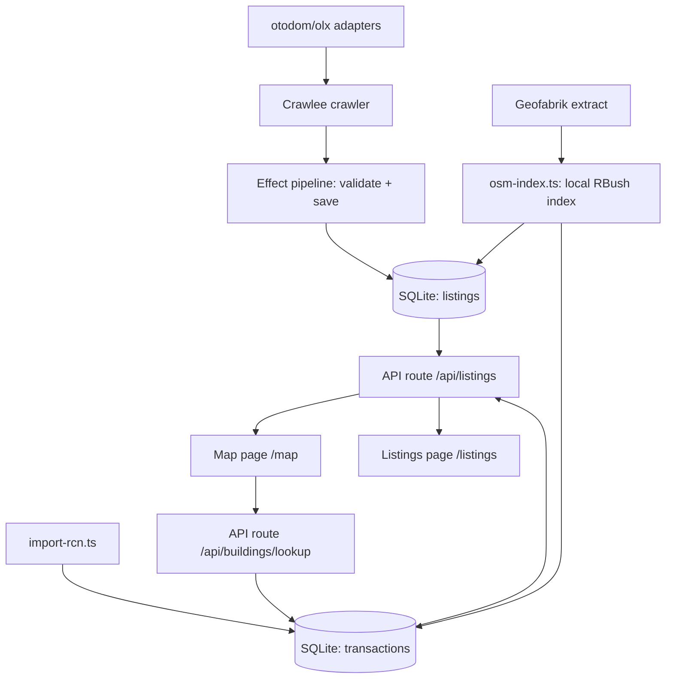

<!-- intent-skills:start -->
## Skill Loading

Use the repository’s installed Intent. If it is unavailable, run `bun install` instead of downloading a replacement.
Before editing files for a substantial task:
- Run `bun run intent list` from the workspace root to see available local skills.
- If a listed skill matches the task, run `bun run intent load <package>#<skill>` before changing files.
- Use the loaded `SKILL.md` guidance while making the change.
- Monorepos: when working across packages, run the skill check from the workspace root and prefer the local skill for the package being changed.
- Multiple matches: prefer the most specific local skill for the package or concern you are changing; load additional skills only when the task spans multiple packages or concerns.
<!-- intent-skills:end -->

# Flat Tracker — Agent & Contributor Guide

Krakow flat-price tracker: scrapes sale listings from otodom.pl and olx.pl,
joins them with historical transaction prices from Poland's Rejestr Cen
Nieruchomości (RCN), and shows every offer on a map anchored to its
OpenStreetMap building.

## Agent skills

Project skills live in `.agents/skills/` and are symlinked into
`.claude/skills/`; `skills-lock.json` pins their sources and hashes.

- `typescript-style-guide`: TypeScript and React conventions. Biome and this
  file's conventions take precedence.
- `vercel-react-best-practices`: React performance. Ignore its Next.js-only
  rules; this app is TanStack Start.
- `web-design-guidelines`: UI and accessibility audit rules.
- `frontend-design`: visual direction for bespoke UI.
- `shadcn`: component-system usage; `components.json` is the source of truth.
- TanStack framework skills: versioned inside `node_modules`, listed and
  loaded through `bun run intent list` and `bun run intent load`.

Precedence: this file and existing code patterns > `components.json` >
`typescript-style-guide` > design and performance skills. A skill must not
override a documented project convention.

## Stack

- **Framework**: TanStack Start (React 19, file-based routing in `src/routes/`)
- **Scraping**: Crawlee 3 + Cheerio (most adapters parse embedded JSON/API
  responses, no browser needed); the WAF-protected sources (booking,
  licytacje-komornik) and the calendar tasks run camoufox through
  `src/crawler/browser.ts` — the only place that launches a browser.
- **DB**: SQLite + Drizzle ORM (`drizzle-orm/better-sqlite3`)
- **Orchestration**: Effect TS wraps the crawl pipeline (`src/crawler/pipeline.ts`)
- **Geocoding**: Overpass API (free) — building footprints + point-in-polygon
- **Map**: mapbox-gl (light-v11 style) with 3D buildings
  (`fill-extrusion` layer), listings as a GeoJSON circle layer,
  `maxBounds` = the union of the tracked region boxes (Małopolska + Śląsk)
  plus a little slack (a tight box makes `fitBounds` crop the north and south),
  default camera fitted to both. Token: `VITE_MAPBOX_TOKEN` in `.env.local` (public
  `pk.` token — restrict it to the app domain in the Mapbox dashboard).
  Free tier: 50k map loads/month.
- **Runtime note**: `better-sqlite3` crashes under Bun's own runtime
  (verified on Bun 1.4.0), so a TS entry point must never be executed *by*
  bun (`bun src/crawler/...`, `bun file.ts`). Run it through tsx, which the
  package scripts already do (`bun run assign-buildings`).

## Toolchain: bun first

Use **bun** for everything it can do: `bun install` (the lockfile is
`bun.lock`), `bunx <tool>` instead of `npx <tool>`, and `bun run <script>` to
run package scripts — including scripts that open SQLite, because
`bun run assign-buildings` executes `tsx` (Node) rather than the file itself.
The single exception is above: never hand a DB-touching entry point straight
to bun's runtime. `bun run dev` is fine — Vite/Nitro run under Node either way.

Do not write `npx` anywhere (docs, comments, log messages). Where a tool has
to come from the project's own dependency tree, name its bin explicitly, e.g.
`bunx camoufox-js fetch` (the registry package `camoufox` is a different,
unrelated package).

## Commands

```bash
bun install               # dependencies (bun.lock is the lockfile)
bun run dev               # start dev server (vite, port 3000); kicks off a background
                          # data refresh on boot (see `server/plugins/refresh-on-start.ts`)
bun run db:generate       # new migration from schema changes
bun run db:migrate        # apply migrations
bun run assign-buildings  # match listings/transactions to OSM buildings
bun run geocode-addresses # geocode listings that carry only an address
bun run import:rcn-gugik       # małopolska RCN packages (cadence-gated)
bun run import:rcn-gugik:all   # every GUGiK powiat in Poland (resumable drain)
bun run discover:rcn-powiats   # refresh the GUGiK package catalogue
bun run build:powiats     # regenerate src/data/region-powiats.ts (Overpass)
bun run validate:powiats  # dataset sanity: counts, city centres, overlaps
```

### Fresh clone: zero-setup bootstrap

`bun install && bun run dev` must work on a clone with no `.env.local` and no
database:

- `src/db/index.ts` defaults `DATABASE_URL` to `./dev.db` (empty value in
  `.env.local` counts as unset) and creates the parent directory if the path
  has one.
- The same module auto-applies `drizzle/` migrations on first use
  (`src/db/migrate.ts`), so every entry point — dev server, Nitro task, tsx
  scripts — gets a working schema. Re-runs are no-ops via drizzle's
  `__drizzle_migrations` journal. A DB that has tables but no journal (made
  with `db:push`) is skipped with a warning instead of failing mid-migration.
- The dev-start refresh then crawls every portal and fills the DB gradually;
  reference layers (RCN zip, Geofabrik PBF, GUGiK powiat packages) download
  into `data/` on first run.

Keep it that way: nothing user-facing may require an `.env.local` or a manual
migration step to boot.

**`.gitignore` trap:** the crawl-data rules are `/data/` and `/storage/`
(root-anchored). A bare `data/` also matches `src/data/**`, which silently
kept `src/data/region-powiats.ts` out of every clone while
an API route imported it — the route tree then failed to
load and *every* page 500'd. Never un-anchor those rules, and keep route-level
imports of optional datasets lazy (`await import()`) so a missing data file
degrades one endpoint instead of the whole app.

### Incremental detail enrichment (otodom)

A `firstPageOnly` run gets one request per source unless the adapter asks for
more (`AdapterBase.firstPageOnlyRequests`). otodom spends 9: the newest list
page plus up to 8 detail pages, and only for offers whose detail was never
parsed (`listings.features` is the marker). Detail pages are the only source
of a flat's coordinates, `build_year`, building material/floors, condition and
market — `db-sink` promotes those out of the `features` JSON into columns — and
otodom's CDN rate-limits bulk detail crawls, hence the small budget. A full
crawl (no `firstPageOnly`) still follows every recent detail page.

### Building age

The official registry sources carry no construction year: the Kraków RCN
GML (`RCN_Budynek` = id, rodzaj, geometria, adres), the GUGiK RCN
GeoPackages (`bud_*` = id, nr, rodzaj, pow_uzyt, cena, adres) and KIEG EGiB
`ms:budynki` (ID_BUDYNKU, RODZAJ, KONDYGNACJE_NADZIEMNE/PODZIEMNE) all lack
one — checked, do not re-investigate those. The portals that do publish it
are nieruchomosci-online (detail LD+JSON `additionalProperty` "Year built")
and otodom (detail attributes `build_year`); both are parsed into
`listings.features.build_year` and promoted by db-sink. `buildings.build_year`
is derived by `updateBuildingYears()` in
`assign-buildings`: the average `listings.build_year` of the listings anchored
to the building, else the OSM `start_date` tag, else null (never guessed).
`/api/buildings/lookup` returns it and the map popup renders it as
"Rok budowy: 1998 · 28 lat".

Browser binaries are a separate download and their absence must stay
non-fatal (reported once per refresh by `src/crawler/browser.ts`). Every
JS-rendered source — booking, licytacje-komornik, and the booking/airbnb
calendar tasks — goes through that one module, which prefers **camoufox**
(`bunx camoufox-js fetch`, ~660 MB, the anti-detect Firefox that also gets
past Booking's DataDome) and falls back to Playwright chromium only if it is
installed (`bunx playwright install chromium`). Camoufox is a Playwright
driver (playwright-core launches its Firefox build), so the library stays;
what is optional is Playwright's *browser download*. `camoufox-js` is a
runtime dependency for that reason. Adapters that need a browser declare
`launchBrowser` (`CustomLaunchAdapter`), which `crawler.ts` calls instead of
letting Crawlee launch chromium. A failed crawl logs a single line (deepest
cause); `CRAWL_DEBUG=1` prints the raw error, and the same line is what
`crawl_runs.error` / `/sources` show.

Crawling is triggered from the UI, not the terminal: the **/sources** page
("Refresh now" → `POST /api/refresh`) runs the same `refreshAll()` as the
hourly task. The old `crawl:*` / `import-rcn` CLI scripts were removed.

`geocode-addresses` fills the coordinate gap for portals that hide
lat/lng (morizon, gratka, domiporta, nieruchomosci-online,
licytacje-komornik): the adapters parse a street address
into `listings.address`, this script matches it against the local
`osm_buildings` index (exact street+housenumber → building centroid,
street-only → street centroid) and falls back to Photon (1 req/s,
validated to the tracked regions) for street-level points. Photon queries
carry no voivodeship suffix — one breaks Śląskie lookups
("ul. Mariacka 10, Katowice, Małopolska" returns nothing, "Bytom,
małopolskie" returns clothes shops in Kraków); the postal code is the
qualifier that works in both. Listings
WITHOUT a stored address get one mined from their title (ad speak like
"Łokietka 57B - mieszkanie 30 m²") — the extracted address is persisted.
Free-text mining also runs when a stored address is parseable but resolves
nowhere in the local index (junk like "Padniewskiwgo") — a mined address
that resolves locally replaces it, one that does not leaves it untouched.
Besides the "Street 12" regexes, titles yield conservative lexicon hints
(`lexiconStreetCandidates` in `sites/address.ts`): bare street names in
parentheses ("Kobi House Kraków (Kobierzyńska)") and the halves of tight
hyphen pairs ("Kapelanka-Pychowicka", "Kraków-Grzegórzecka"), accepted only
on exact lexicon resolution (a one-word bare hit must be an exact lexicon
form — declension stems are a trap).
Re-run `assign-buildings` afterwards to anchor the new points. Komornik
titles are legal notices ("... przy ul. Szkolnej dla której SR dla
Krakowa-Krowodrzy w Krakowie ..."), so geocoding cuts the court
boilerplate ("dla której", "Sąd/SR", "Wydział", "KW nr", "z siedzibą")
before mining a street or city — the court's seat is not the property's
location. Bare notarial phrases ("prawo użytkowania wieczystego",
"działka nr 41/6") are rejected as street candidates; explicitly prefixed
streets ("ul. Prawa 5") still pass. For the same reason a city mined from a title only overrides a
generic hint (Kraków/małopolskie/a district); a specific town from the
structured address always wins. The offline town centroid is only used
for unambiguous names: where one village name exists twice in the region
(two "Leśnica"), the centroid map skips it and Photon resolves the name
together with the postal code from the address.

The same pass runs automatically inside every `refreshAll()` with a
Photon budget of 100/run (local index matches are instant), so the
map stays populated between manual drains. Geocoded positions survive
re-crawls: `saveListings` coalesces coordinates, `address` and
`description`, so address-only adapters never overwrite them with NULL
(a plain `excluded.address` here once wiped 28 geocode-mined budujesie
addresses on the next full re-crawl — every nullable column a re-crawl
can re-emit as NULL must be coalesced in `onConflictDoUpdate`). Street-only addresses anchor
to the local street centroid (no building claim); Photon results
are cached per street in `data/crawler/nominatim-cache.json` (legacy
filename) so
duplicate offers and chunked drain runs never re-query. Pass
`--local-only` to the script to skip Photon (e.g. while the shared
instance throttles).

## Scheduled (hourly) refresh

Crawls are incremental and idempotent, designed for a once-per-hour cron.
The server itself runs the refresh: a Nitro scheduled task `refresh`
(cron `0 * * * *`, wired in `vite.config.ts` -> `scheduledTasks`,
`experimental.tasks`) executes `refreshAll()` from `src/crawler/refresh.ts`.
It runs in dev AND prod node servers, and the dev server additionally fires
one refresh on startup (`server/plugins/refresh-on-start.ts`, gated on
`import.meta.dev`). That boot crawl runs in a **child process**
(`server/boot-refresh.ts`, launched as `node --import tsx`), not through
`runTask`: Vite's dev module runner would otherwise load the whole crawler
graph inside the server process, and that first load blocked every request
for minutes on a cold start. Live progress and the cross-process
single-flight guard travel through `data/crawler/refresh.json`
(`src/crawler/refresh-lock.ts`): `/api/crawl-status` merges it, `/api/refresh`
reports it as already running, and `refreshAll()` refuses to start while a
live child holds it.

Manual equivalents:

```bash
# /sources page "Refresh now" button → POST /api/refresh (recommended)
curl -X POST http://localhost:3000/_nitro/tasks/refresh   # server task
```

`refreshAll()`: refetches all sources, upserts new/changed listings, prunes
otodom/olx listings older than the since window (default 90 days), then
refreshes RCN transactions (HEAD check; skips when nothing changed) and the
region-wide GUGiK per-powiat GeoPackages — małopolska scope by default
(20 h cadence gate, effectively daily on the hourly cron); set
`RCN_GUGIK_SCOPE=poland` to make the server refresh cover the whole country
instead. When either import inserts new rows, building assignment
(`assign-buildings`) re-runs automatically so new price history shows up
colored on the map.
Portal failures are isolated per site (one blocked portal does not abort
the rest of the run). The task and plugin are registered explicitly in
`vite.config.ts` (no Nitro directory scanning — TanStack Start owns
`src/routes`); the handler path must be an absolute file URL, relative
paths fail to resolve from the virtual tasks module.

**Whole-country loads are a manual drain** (`bun run import:rcn-gugik:all`):
GUGiK publishes one GeoPackage per powiat nationwide (380 packages,
~5.3 GB), so it is not something an hourly server task should pull. The
run is resumable — `data/rcn/gugik/state.json` records the last successful
import per TERYT4, and the cadence gate skips those powiaty on a re-run —
and idempotent, so interrupting it costs only the powiat in flight. The
package catalogue lives in `data/rcn/gugik/teryt-index.json`, discovered
by HEAD-probing the URL space (`bun run discover:rcn-powiats`,
`src/crawler/rcn-gugik-index.ts`); discovery is additive so a flaky probe
can never shrink the catalogue. Kraków (1261) is skipped in both scopes:
`import-rcn.ts` already imports the richer city GML, and a second copy
under `1261-G/...` ids would double-count Kraków in the building price
history. Rows outside the tracked regions keep their registry coordinates
but stay unbound — the `osm_buildings` index covers małopolskie + śląskie.

### Transaction scope: the tracked regions, explicitly

`transactions` holds the country, but **every screen is regional** —
listings come from małopolskie and śląskie portals, the choropleth and the
price charts cover both voivodeships, the map is bounded to the union of
their boxes. So a
bare `FROM transactions` in a route is a bug waiting for the next national
drain: it silently turns a Kraków chart into a national average, and the
choropleth would push ~20M out-of-region rows through point-in-polygon on
every request. Regional queries therefore carry `inTrackedRegions` from
`src/db/region.ts`.

Two consequences worth knowing:

- **The region is a column, not a coordinate test.** `TRACKED_REGIONS`
  (src/db/region.ts) holds the two boxes, `transactions.region` is a VIRTUAL
  generated column that turns them into `'malopolskie'` / `'slaskie'` /
  NULL, and queries say `region is not null` — the predicate
  `transactions_region_price_idx` (schema.ts) is partial on, verbatim. A
  single-voivodeship slice is `inRegion("slaskie")`, still bounded by that
  index (measured 0.8 s vs 0.3 s index-only region-wide for the monthly
  price series). The indirection is not cosmetic: SQLite does not match a
  partial index whose WHERE clause is OR-connected, so the two boxes written
  as `(box) or (box)` — identically in the index and in the query — still
  planned as `SCAN transactions` (8.1 s at 24.3M rows; `INDEXED BY` answers
  "no query solution"). One box covering both voivodeships does match an
  index but swallows Kielce and Opole. `bun run validate:regions` compares
  the stored generated expression, both predicate texts and the resulting
  `explain query plan` with the code, so a drifting box fails loudly instead
  of mis-bucketing new rows.
- Rows without geometry never carry a `region` (the column is derived from
  `lat`/`lng`), so they drop out of every region-scoped aggregate. They could
  never be attributed to a powiat anyway, and the coordinate boxes cover
  each voivodeship's full extent, so no in-region point is left unlabelled
  (`validate:regions` asserts exactly that over the whole table).

The per-powiat choropleth (`/api/powiat-map`) was removed in the analytics
cleanup. The region-scope machinery it used is still the contract for every
analytics query: `transactions.region` plus the two partial indexes. The
`region` column also lets the per-powiat series use the date-first index
(`transactions_region_date_idx`) instead of scanning the national
`parcel_id` index; `validate:regions` asserts that plan.

**Server refreshes fetch only the first, newest-sorted page per site**
(`firstPageOnly: true`, the default in `refreshAll`): each hourly run
captures just the offers that appeared on page 1 and skips pagination and
detail-page follow-ups. `alwaysFullCrawl` opts a source back into full
pagination (investmap: small private investments sit past pages that have
no flats, so skipping page 1 would hide them; licytacje-komornik: the
Małopolska + Śląsk court-auction feeds are tiny, so every run re-syncs the whole
list; budujesie: the forum list is sorted by last-post activity, so the
deep pages hold the corpus and every run re-syncs all ~52 topic pages).

**Dev-start runs are diff-only** (`server/boot-refresh.ts` calls
`refreshAll({ sinceDays: DEV_SINCE_DAYS, diffOnly: true })`): each site's
`since` window is `max(now - 7 days, last successful crawl)` — per-site
last-run timestamps live in `data/crawler/state.json` — so a boot only
loads what the portals added since the previous load, and otodom/olx
history is pruned to the 7-day cap. Dev-start runs are also first-page-only.

- Upserts by `(source, externalId)`: re-running is safe and self-refining
  (detail pages add coordinates to list-page records). Each run reports
  the portal diff — how many listings are NEW vs UPDATED.
- Cross-source dedupe in `/api/listings`: rynekpierwotny project rows are
  hidden when the same investment is covered by investmap (exact
  street+housenumber, street-only when the project has no housenumber,
  or normalized investment-title match). Both sources remain selectable
  individually in the UI filters.
- The fetch window is bounded by `sinceDays` (default 90) and older
  otodom/olx listings are pruned afterwards, so the DB only holds
  active/recent offers.
- `importRcn()` starts with a HEAD request on the
  zip; when ETag/Last-Modified match `data/rcn/version.json`, it skips
  the 2 GB download+parse and reports 0 new transactions. When the file
  changed, only rows that are actually NEW are inserted
  (`INSERT OR IGNORE ... RETURNING`), so each run imports exactly the
  diff the registry added.
  Run `bun run assign-buildings` after an RCN refresh to anchor the new
  transactions.
- The crawler paces requests (3 concurrent, ~350 ms delay) and retries
  403s with backoff to stay under portal throttling. Note: Crawlee swaps
  `enqueueLinks` for a no-op stub on non-HTML responses, so JSON-API
  adapters (investmap, komornik) paginate via `addRequests` instead.
- **Blocked portals stop, they never get hammered**: a 429 (or 5 blocked
  403 attempts) ends that source's crawl immediately
  (`blockStatus`/`makeBlockTracker` in `crawler.ts`; `retryOnBlocked: false`,
  `maxRequestRetries: 2`, and `request.noRetry` on the first 429) and the
  source is paused for 2 h via `blocked:<site>` in
  `data/crawler/state.json`. The next `refreshAll()` skips it entirely —
  not one request — and the run summary says "blocked earlier — retry
  after HH:MM". "Try later", never "try again now". A single burst-403
  (otodom/olx) keeps its bounded retries and does not trigger the pause.
- **The hourly cron runs whatever build is deployed**: the Nitro task lives
  in the server process, so a stale `:4173` prod build keeps scraping with
  old adapter logic — observed re-upserting 854 rows a fresh prune had just
  removed, within the hour. Rebuild + restart the prod server whenever crawl
  logic changes (`bun run build`, then relaunch `.output/server/index.mjs`).
- `runCrawlWithRetry` (exponential backoff) backs every site crawl in the
  server refresh task.

`assign-buildings` uses a **local OSM building index** (`osm_buildings`
table) built from one Geofabrik extract per tracked voivodeship
(`data/osm/malopolskie.osm.pbf` and `slaskie.osm.pbf`, ~200 MB each,
streamed with `osm-pbf-parser`). The index covers **both voivodeships** in
full (not just Kraków), so region-wide sources (booking, airbnb: Zakopane,
Katowice, ...) anchor too.
Point-in-polygon matching then runs in-memory via RBush — the public
Overpass API is far too rate-limited for the ~84k RCN transactions. The
index is rebuilt automatically when missing *or built from an older region
set*: `data/osm/build-state.json` records which extracts the current rows
came from, so adding a voivodeship triggers exactly one rebuild (the table
is replaced, not merged — a footprint row does not record its extract).
`bun run assign-buildings`
assigns all 84k transactions in minutes, not hours.

Both the rebuild and the matching index are memory-shaped for the server
process, because that is where they run (the refresh calls
`assign-buildings`): ~3.2M footprints are loaded at a time and the default
V8 heap is 4.4 GB. What that costs, measured on dev.db: a typed array per
footprint plus a parsed tag object peaked at 3.9 GB (one OOM away from
killing the dev server), so rings now live in a single shared `Float64Array`
addressed by offset/count, rows are read in pages instead of one
`select()`, and `polygon`/`tags` are fetched per building only when a
footprint is first inserted into `buildings`. Same load, 1.7 GB, and the
whole flow (parse two extracts, insert, load, probes) finishes in ~3.5 min
with the build's peak at ~2 GB. If you touch the loader, watch
`process.memoryUsage()` — the failure mode is a crash, not a slow run.

## Data sources

| Source | What | Access |
|---|---|---|
| otodom.pl | Active sale listings — flats, houses and plots — Małopolska + Śląsk | HTML `__NEXT_DATA__` JSON; list pages have no coords, detail pages (`/pl/oferta/`) add lat/lng, `build_year`, building material/floors, condition, market (`attributes`, promoted by db-sink). The sale adapter walks `/sprzedaz/{mieszkanie,dom,dzialka}/{region}`; `estate`/`category.id` set the row's property kind |
| otodom.pl (wynajem) | Long-term rental listings — flats, houses and plots — Małopolska + Śląsk | Same `__NEXT_DATA__` path, `/wynajem/{mieszkanie,dom,dzialka}/{malopolskie,slaskie}`; detail price read from `rentalPrice` |
| olx.pl | Active sale listings — flats, houses and plots — Małopolska + Śląsk | HTML `window.__PRERENDERED_STATE__` JSON incl. coordinates; the regional landing page carries all three categories and the adapter keeps category ids 14/15/16 (flats), 18/20/22 (houses) and 24/25/1311 (plots). The rent adapter reuses the same landing with the `wynajem` ids (15/20/25) |
| morizon.pl / gratka.pl | Same feed (one company), agency-heavy; flats, houses and plots | schema.org LD+JSON (`Offer` nodes); pagination `?page=N`. The result cards carry "Dodane: YYYY.MM.DD", parsed into `listedAt`; `itemOffered.@type` (`Accommodation`/`House`/`Place`) sets the property kind |
| domiporta.pl | Agency listings: flats, houses and plots | LD+JSON `@graph` `ItemList` of `RealEstateListing`; pagination `?PageNumber=N`; `datePosted` is the posting date and the URL slug supplies the kind |
| nieruchomosci-online.pl | Agency listings: flats, houses and plots | LD+JSON `CollectionPage` offers (`?1,dom`, `?2,dzialka`, `?3,mieszkanie`); pagination `&p=N`. The list has no date or coordinates, so a detail pass (max 8 uncached details per list page, cached in `data/crawler/nieruchomosci-online-details.json`) fills `listedAt` from `datePosted` plus `geo` coordinates |
| rynekpierwotny.pl | New-development projects (osiedla): flats and houses | `window.__INITIAL_STATE__` `offerList.list.offers` with geo points + price ranges; `/s/nowe-mieszkania-*` and `/s/nowe-domy-*`, pagination via the state `next` link. The list omits the posting date; a cached detail pass (max 6 uncached details per list page, `data/crawler/rynekpierwotny-offers.json`) reads `offerDetail.offer.configuration.publish_date` (fallback `create_date`) |
| investmap.pl | **Every registered investment in Kraków and Katowice with its flats or houses** (incl. small private ones) | Public JSON API `GET /api/investment/search?withEstates=1&categorySlug={mieszkania,domy}&citySlug={krakow,katowice}&offset=N` — units inline (`es[].list`): area, price, price_m2, floor, rooms; coordinates from the investment. Construction timeline: `GET /api/investment?id=<id>` carries `investment.finish` (`{title: "I kw. 2026", date: "2026-01-01"}` = the "realizacja" quarter shown on /miasto/krakow, quarter-start date, planned or actual, the source does not distinguish; search rows only hold empty `finish: {}` placeholders). Stored per unit as `construction_end_label`/`construction_end_date` in `features`, promoted to columns, exposed by /api/listings as `constructionEndLabel`/`constructionEndDate`. Investmap publishes NO construction start date and NO status field (checked the whole API surface), so none are stored. Detail fetches are gated by `data/crawler/investmap-investments.json` (30-day TTL). Investments with NO units for sale (sold out, early phase) would otherwise be invisible entirely: the adapter emits one price-less investment-level row per building (`externalId` `inv-<id>`, `features.investment_row`), and `/api/listings` hides that stand-in again once unit rows for the same `features.investment_id` appear |
| licytacje.komornik.pl | Court auction notices (Małopolska + Śląsk real estate, all subcategories) | Playwright only (WAF blocks non-browser TLS); anonymous JSON API `POST /services/item-back/rest/item/search` (same-origin, `termFilters` + `fullTextFilters` city, `offset` pagination); every REAL_ESTATE subcategory kept |
| budujesie.pl | Investments under construction (Kraków housing), one phpBB topic per investment | Plain prosilver DOM cards (`viewforum.php?f=5`, 25 topics/page, `start=N` pagination); rows are long-lived inventory with no price — the map renders them as their own hard-hat symbol layer. The popup label is activity-aware: "Inwestycja w budowie" only while the thread is alive (last post within 18 months), else a factual "ostatnia aktywność MM.YYYY" — the site carries no construction status, so archived topics must not claim to be building. The adapter also fetches each topic's first page (gated per topic by `data/crawler/budujesie-topics.json`, keyed on `lastPostAt`, so only moved threads are re-fetched): the OP text becomes `description` and the preferred address source (post prose beats title mining and resolves the town — "powstaje przy ul. X w Wieliczce"), and up to 8 posts go into `features.posts`, rendered as the description + comments under the investment in the map popup and the listings expanded row. phpBB date quirks and the thread/OP-address parsing are pinned by `scripts/validate-budujesie.ts`. **Corpus = last 2 years** (`RECENT_WINDOW_DAYS = 730`): a topic is kept when it was started *or* last discussed inside the window (the 2004–2015 backlog is rebuild noise, ~60% of the threads); the OP text always survives (it is the investment description) while replies are date-filtered. Reply dates come from `p.author` ("autor: X » 25 wrz 2026, 12:44") — `<time datetime>` never matches this forum's markup — and cached thread entries with undated posts are re-fetched once. `pruneStaleBudujesie` (db-sink, FK-safe) drops rows the window evicted on every refresh's prune phase. Location is mined from the thread: OP prose first, then the title, then *comments* (a comment naming another town never displaces the agreement, and a comment-mined address must be a lexicon street or explicitly prefixed — bare "Word Number" / estate-name prose matches are rejected, they produced junk like "Zreszta 5"). Estate-name addresses ("Plaszov Carlo", "Villa Botanica") are honest geocode misses: no street to match locally and Photon does not know the marketing name either |
| airbnb.pl | Short-term rentals, Małopolska + Śląsk | Quadtree-partitioned search pages (`data-deferred-state-0` embedded JSON) plus a detail pass for room type, amenities and coordinates; Airbnb publishes no listing creation date, so `firstSeenAt` is the added date |
| booking.com | Short-term rentals, Małopolska + Śląsk | Camoufox/Playwright only (DataDome); property cards plus the Apollo cache for coordinates; Booking publishes no listing creation date, so `firstSeenAt` is the added date |
| RCN (Rejestr Cen Nieruchomości) | Historical notarial transaction prices, Krakow, free since 2026-02-13 | GML zip: `https://rzeczoznawca.eco.um.krakow.pl/RCN/1261_RCN.zip` (~2 GB) |
| GUGiK RCN (Usługa Transakcje) | Same, but every powiat in Poland: the tracked voivodeships (małopolskie + śląskie) by default, the rest on demand (per-powiat GeoPackages; parcel/building/lokal transactions) | `https://opendata.geoportal.gov.pl/InneDane/latest_exports/rcn_transakcje_ceny/GPKG/{teryt}_transakcje_ceny.gpkg.zip` — imported by `import-rcn-gugik.ts` (`bun run import:rcn-gugik`, `bun run import:rcn-gugik:all`) |
| OpenStreetMap (Overpass) | Building footprints/addresses | Free API, rate-limited, 3 mirror endpoints |

### RCN GML structure (import-rcn.ts)

Features joined by `gml:id` xlink refs:
`RCN_Transakcja --podstawaPrawna--> RCN_Dokument` (date),
`RCN_Transakcja --nieruchomosc--> RCN_Nieruchomosc` (geometry),
`RCN_Nieruchomosc --lokal--> RCN_Lokal` (area/rooms/floor),
`RCN_Lokal --adresBudynkuZLokalem--> RCN_Adres` (street/number).
We import only `rodzajTransakcji=1` (sales) of `funkcjaLokalu=1` (apartments).
The parser streams with `saxes` — never load the 2 GB file into memory.

Gotchas:

- **CRS is PL-2000 zone 21, not WGS84.** `<gml:pos>` values are easting
  northing in `EPSG:2180` (`+proj=tmerc +lon_0=21 +k=0.999923 +x_0=7500000`).
  `parsePos` converts with `proj4`; sanity bounds are easting
  7_400_000..7_460_000, northing 5_520_000..5_580_000.
- **Dates can be registry typos**: GUGiK ships a handful of rows with
  impossible `dok_data` (year 9202, year 14 — 104 future-dated and 509
  pre-1990 rows in 4.77M). They are imported as-is (the table mirrors the
  registry), and every chart filters by date range so they never show up;
  the building price history does not filter, so a single bogus date there
  is cosmetic, not broken.
- **Geometry lives on `RCN_Dzialka`/`RCN_Budynek`**, not on the
  `RCN_Nieruchomosc` (which only carries xlink refs). The importer resolves
  pos via `nieruchomosc -> dzialka|budynek`.
- Nested elements like `RCN_IdentyfikatorIIP` also start with `RCN_`; the
  parser only starts/ends a feature on matching open/close tags.

## Architecture



Clicking a 3D building on the map queries `/api/buildings/lookup?lat&lng`
(point-in-polygon over the `buildings` table, 30 m nearest-centroid
fallback) and shows the building's RCN price history: transaction count,
average/range zł/m², year-by-year breakdown and the 5 most recent sales.
This is the same RCN data that portals like deweloperuch.pl aggregate —
imported locally by the refresh pipeline (`import-rcn.ts`), no extra
scraping needed.

### Property kind filter (dom / mieszkanie / działka)

Map and listings filter by property kind via `propertyKind` on each
`/api/listings` row, derived once in `src/lib/property-kind.ts` and shared
by both screens. Every listing adapter now crawls all three kinds where the
portal has them and writes the kind it actually saw into
`listings.propertyType`: otodom's `estate`
(`FLAT`/`HOUSE`/`TERRAIN`) and detail `category.id` (101/201/401 sale,
102/202/402 rent), OLX's
category id, morizon/gratka's `itemOffered.@type`, the category segment of
a domiporta/nieruchomosci-online URL, rynekpierwotny's `type` (1/2) and
investmap's `es[].label`/category. The classifier trusts that value first,
then honest title hints ("działka"/"nieruchomość gruntowa" → plot,
"budynek mieszkalny"/"bliźniak" → house), and only then the source's
historical feed semantics. Rows with no evidence and no legacy feed
default stay untyped and show only under "Wszystkie" — a guess would
misfile them; when adding a source, feed the classifier real signals (or
leave it untyped) rather than defaulting.

### Posting dates and the "Data dodania" filter

`listings.listedAt` is the portal's own posting date whenever the feed
publishes one; `firstSeenAt` is only the fallback for sources that do not.
Both the map's day selector and the listings table's "Data dodania" filter
use `listedAt ?? firstSeenAt` for **every** source — there are no evergreen
exceptions (budujesie threads and investmap investment rows filter like
everything else). The portal dates come from: otodom `dateCreated`, OLX
`createdTime`, morizon/gratka card "Dodane", domiporta `datePosted`,
komornik's notice date, budujesie's topic-start date, and the cached detail
passes of nieruchomosci-online (`datePosted`) and rynekpierwotny
(`publish_date`/`create_date`). airbnb/booking/investmap publish no
posting date, so their rows fall back to `firstSeenAt`.

### Listing feeds: map vs table

`/api/listings` has two shapes. The default `view=map` returns every
surviving row with the map anchor, per-building `transactionStats`, and the
compact feature payload the popups read. `view=table&page=N&pageSize=100`
returns only the columns the table renders, plus `total` and the
source/kind facets; `/listings` uses it so opening the table does not
download the map feed. Both shapes share the same dedupe pipeline
(`loadVisibleRows`) and the same `filterListings` classifier.
The map shape is ~35 MB raw (~30k rows today), so `src/lib/server-response.ts`
gzips it to ~3.9 MB (`Vary: Accept-Encoding`) and `withCache` holds the
serialized/gzipped body for 60 s; non-gzip clients still get the raw body.

`/api/buildings/labels` accepts `?bbox=minLng,minLat,maxLng,maxLat` and is
called by the map only above zoom 15.2 for the current viewport. The
request is rejected without a bbox; `?all=1` is the explicit ~38 MB dump
and must not be used by a page.

### Adding a new site (e.g. Facebook Marketplace, Morizon)

1. Create `src/crawler/sites/<site>.ts` exporting a `CheerioAdapter` (or
   `PlaywrightAdapter`) from `src/crawler/types.ts`.
2. Implement exactly one extraction strategy:
   - **DOM cards**: `listingSelector` + `parseListingCard($, el)`
   - **Embedded JSON**: `extractHtml(html, url, enqueue)` — return listings,
     call `enqueue(urls)` for detail pages / pagination (see `otodom.ts`)
   - **LD+JSON**: many Polish portals (morizon, gratka, domiporta,
     nieruchomosci-online) embed their feed as schema.org JSON. Use
     `parseLdJson`/`findLdNodes` from `ldjson.ts`, or the
     `makeLdOfferAdapter` factory for the shared Morizon/Gratka shape.
3. Register it in `src/crawler/sites/index.ts`, and add a descriptor to
   `src/crawler/source-status.ts`. The **/sources** page and
   `/api/crawl-status` read that STATIC literal (it must not import
   `sites/index.ts` — see its header comment), so a source registered only
   in the adapter graph gets crawled but stays invisible on the status page.
4. Test: trigger a refresh from the **/sources** page (or POST
   `/_nitro/tasks/refresh`) and watch the new site's row on the status page.

Normalized `Listing` shape: see `types.ts` (source, externalId, url, title,
price, pricePerM2, areaM2, rooms, floor, district, lat, lng, listedAt).

### DB schema (`src/db/schema.ts`)

- `listings` — active offers; unique `(source, externalId)`; upserted by the
  sink, so detail-page records refine list-page records
- `buildings` — OSM buildings referenced by listings/transactions
  (osmId unique, address, tags, geometry)
- `osm_buildings` — local OSM footprint index for małopolska (bbox, centroid,
  polygon JSON); built from the Geofabrik extract by `osm-index.ts`
- `transactions` — RCN history; unique `transactionId`

## Building assignment

- **Listings** (`assignBuildingsToListings`) — point-in-polygon against the
  local `osm_buildings` index; portal coordinates are approximate so a
  nearest-centroid fallback within 40 m is used.
- **Transactions** — **address-first** (`matchByAddress` in
  `address-index.ts`): RCN transactions carry street + housenumber from
  notarial records, matched exactly against OSM `addr:street` +
  `addr:housenumber`, gated by the transaction's own coordinates (same
  street + number can exist in several towns, so matches farther than
  300 m from the record's point are rejected). Without an
  address match, fall back to `matchPointStreetAware`: point-in-polygon,
  then a 150 m street-aware fallback. Re-running the script corrects any
  geo-fallback assignments that disagree with the address.
- The older Overpass path (`geocode.ts`) remains for ad-hoc lookups but is
  not used for bulk assignment (rate-limited: 429s on all mirrors).
- `buildStreetIndex()` / `buildCityCentroids()` (in `address-index.ts`) read
  `osm_buildings` **in pages with a `setImmediate` yield** and memoize the
  result for the process lifetime (`invalidateAddressIndex()` runs when
  `buildOsmIndex()` replaces the table). A single raw `select()` over the
  ~3.2M footprints materialised every row at once and blocked the boot
  refresh (and every HTTP request) for minutes; the paged version keeps the
  event loop responsive and the cache removes the repeat builds that
  `assign-buildings` + geocoding used to trigger in the same run.

## Effect TS usage

`src/crawler/pipeline.ts` models the crawl as an Effect program:

- `CrawlError` (tagged error) — typed failures
- `ListingSchema` — Effect Schema validation of adapter output before saving
- `runCrawl(adapter, saveToDb)` — main program, run via `Effect.runPromise`
- `runCrawlWithRetry(...)` — exponential backoff schedule for cron runs

Keep new pipeline steps in the Effect style: `Effect.tryPromise` with typed
errors, `Schema` for boundary validation, `Schedule` for retries.

## Conventions & gotchas

- Drizzle column names: camelCase unless explicitly named (e.g. `listed_at`).
  In `onConflictDoUpdate`, `excluded.<col>` must match the real column name.
- Overpass rejects generic User-Agents with 406 — `queryOverpass` sends a
  descriptive UA and falls back across 3 mirrors with retries.
- Be polite to free APIs: batching (10 points/request) + 1.2 s delay.
- Crawlee storage: `Configuration({ storageClient: new MemoryStorage({
  persistStorage: false }) })` — truly in-memory, never writes `storage/`
  dirs, and concurrent crawls (dev server + hourly task) can't race over
  queue files on disk.
- **Dev startup: never let Vite scan the server graph, and keep generated
  data out of Tailwind's scanner.** Two independent traps made a cold
  `bun run dev` block every request for minutes:
  (1) Vite's dependency scanner follows the *raw* route tree into the API
  routes and the crawler graph, so it prebundled Crawlee, Playwright,
  better-sqlite3, drizzle and Effect into the client dependency cache (the
  browser never requests them). `optimizeDeps` in `vite.config.ts` now sets
  `noDiscovery: true` with an explicit list of the packages the client
  actually imports — add a client dependency there when introducing one.
  (2) Tailwind v4's oxide scanner never returns from the 2.7 MB single-line
  `src/data/region-railways.ts`; `src/styles.css` excludes the generated data
  modules with `@source not`. Both have the same symptom: the first
  `styles.css` request hangs and every other request queues behind it.
- **Heavy read endpoints are cached and yield**: `/api/market-charts` is a
  sequence of multi-second synchronous better-sqlite3 aggregations.
  `src/lib/server-cache.ts` holds its result for five minutes with
  single-flight, and the shared `all` helper yields between queries so the
  event loop keeps serving other requests while a cold computation runs.
  The first view after a server restart still pays the computation; repeat
  views are milliseconds.
- **Map is client-only**: `mapbox-gl` touches `window` at import time and
  crashes SSR. `src/routes/map.tsx` gates the lazy `import()` behind a
  `useEffect` mount flag — never import mapbox-gl in a route module
  directly. `map-view.tsx` keeps the map instance in a ref; a second
  effect pushes `setData` into the GeoJSON source when the source filter
  changes.
- **mapbox strips nested objects from click features**: what layer click
  handlers get via `e.features` (backed by `queryRenderedFeatures`) keeps
  only primitive properties — nested objects survive as empty shells
  (`transactionStats` lost its `txCount` and the popup's RCN history
  block never rendered for any source). `showListingPopup` therefore
  hydrates the full row from the GeoJSON source data by `id`; keep
  nested data out of click-feature reads or hydrate the same way.
- **Railways/stations overlay** ("Kolej" toggle): generated
  `src/data/region-railways.ts` via `bun run build:railways`, which parses
  the same Geofabrik PBFs `osm-index.ts` uses (Overpass was unusable when
  this was written). Served by `/api/railways` (lazy import), drawn as a
  white-cased dark line + blue station dots with names; regenerate when a
  fresh PBF lands.
- The RCN importer skips the download when `RCN_GML_PATH` points at an
  already-extracted file (handy for testing with a partial slice).
- `src/data/region-powiats.ts` is generated (`bun run build:powiats`,
  cached Overpass responses in `data/powiats/`): powiat boundaries for every
  tracked voivodeship (22 małopolskie + 36 śląskie), one closed ring per
  entry, outer boundaries first then holes, matched with an **even-odd** rule
  so Tarnów/Nowy Sącz are not double-counted into the powiat around them.
  `bun run validate:powiats` checks every city centre. The dataset is now a
  reference source for the TERYT-name validation (`validate:market-charts`)
  rather than a map layer.
- DB access goes through `#/db/index` only. It migrates on import, so a new
  script never needs a manual `db:migrate`; don't open `better-sqlite3`
  directly (except throwaway tools in `scripts/`).
- `scripts/` holds throwaway utilities (db-state, overpass-test).
- Schema gaps that are known and intentional: `todos` is an unused template
  table (no code reads it), and nothing ever sets `listings.is_active = 0`
  (the sink always writes 1) — "active" means "still in the DB", removal
  happens through pruning, not through a sold/withdrawn state.

## Roadmap ideas

- Facebook Marketplace adapter (hard anti-bot; may need Patchright/Camoufox)
- Transaction layer on the map (toggle RCN points per district)
- Price history snapshots per listing (table `listing_history`)
- Cache Overpass results to avoid re-querying on every assignment run
